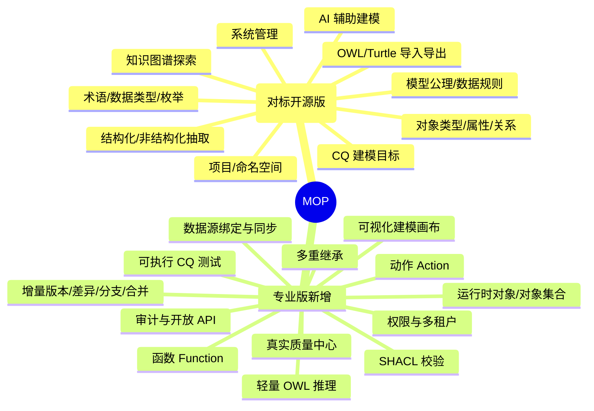

# 《沐曦本体平台专业版 PRD》

| 项目 | 内容 |
|---|---|
| 产品名称 | 沐曦本体平台专业版（Muxi Ontology Platform Pro，简称 **MOP**） |
| 文档编号 | MUXI-ONT-PRD-001 |
| 版本 | v1.0（2026-11-14） |
| 编制 | 武汉沐曦云技术有限公司 · 产品部 / 架构组 |
| 关联文档 | 《qOntology 深度研究报告》（MUXI-ONT-RS-001）、《沐曦本体平台技术开发文档》（MUXI-ONT-TD-001） |
| 代码仓库 | https://github.com/marcusmaomao/Muxi-Tech （默认分支 `main`） |

> **合规前提（必读）**：qOntology 的许可证禁止在未获商业授权的情况下换牌复刻（详见研究报告第 9 章）。本 PRD 所说的“复刻”一律指**能力对标、净室独立实现**：功能与 qOntology 开源版等价，但代码、数据库脚本、提示词和 UI 交互设计全部由沐曦自主设计，不复制 qOntology 的任何受限资产。若商务上决定购买千桐的品牌定制授权，本 PRD 的需求依然适用，只是实现路径改为“基于授权源码二次开发”。

---

## 1. 产品概述

### 1.1 产品定位
**MOP 是面向企业的“可执行本体”平台。** 它在“带 AI 的知识建模工作台”（qOntology 开源版的能力基线）之上，补齐三层能力：
1. **语义可信层**：SHACL 校验、轻量 OWL 推理、可执行 CQ 测试、真实的质量中心。
2. **治理层**：增量版本、差异比较、分支与合并、发布门禁、权限与多租户、审计。
3. **运行时层**：参考 Palantir Foundry Ontology 的 Object / Link / Action / Function 概念，把本体从“文档”变成“能运行的业务对象系统”，包括对象实例、对象集合、数据源同步、动作写回和函数计算。

一句话定位：**“建得准（AI+CQ）、验得严（SHACL+推理+CQ 测试）、管得住（分支/合并/权限）、用得上（对象/动作/函数）”。**

### 1.2 与 qOntology 开源版的差异

| 能力 | qOntology 开源版（实测） | MOP 专业版 |
|---|---|---|
| 建模方式 | 表单 + 单父树 | 表单 + **可视化画布** + **多重继承** |
| 标准 | 语法层 OWL 导出，无 SHACL | OWL 2 导入导出（含公理）、**SHACL 编译与校验**、**OWL RL/EL 推理** |
| CQ | 人工标注是否覆盖 | **可执行 SPARQL/Cypher 断言**，自动计算覆盖率 |
| 质量中心 | 前端写死的分数 | 规则引擎 + SHACL + 推理 + CQ 测试，**真实评分**，并作为发布门禁 |
| 版本 | 全表复制，只有计数 | **增量版本、元素级差异、分支、三方合并、稳定 IRI** |
| 抽取 | 只在提示词里约束，后端不校验 | 输出受 JSON Schema 约束、**后端本体校验**、置信度、实体消解、审核队列 |
| 运行时 | 无 | **对象实例、对象集合、数据源绑定与同步、动作、函数** |
| 权限 | RBAC，租户 ID 写死 | RBAC + 项目角色 + 对象/属性级权限 + **多租户** |

### 1.3 目标用户与角色

| 角色 | 典型岗位 | 核心诉求 |
|---|---|---|
| 本体架构师（Ontology Architect） | 企业架构师、数据架构师、知识工程师 | 设计领域本体、控制质量、发布版本 |
| 领域专家（Domain Expert） | 业务骨干、设计院专业负责人、临床科室专家 | 审核概念和术语、确认 CQ、采纳 AI 候选 |
| 数据工程师（Data Engineer） | 数据中台和 ETL 工程师 | 把业务库和文档绑定到本体，配置同步 |
| 应用开发者（App Developer） | 业务系统开发 | 通过 API/SDK 调用对象、动作、函数 |
| 业务操作员（Operator） | 调度员、运维、医务管理 | 在对象视图上执行动作（审批、派单、状态变更） |
| 平台管理员（Admin） | IT 运维、租户管理员 | 租户、用户、模型密钥、资源配额、审计 |

### 1.4 行业场景

| 行业 | 场景示例 | 关键能力 |
|---|---|---|
| 能源（电网、发电、油气） | 设备资产本体（变电站-间隔-设备-部件-缺陷），从运检规程中抽取缺陷与处置关系；“缺陷升级”动作 | AI 建模、抽取、动作写回、SHACL 校验台账 |
| 交通（轨交、公路、港航） | 线路-车站-设备-工单本体，CQ 示例：“某区段近 30 天影响行车的故障有哪些”；派单动作 | 运行时对象、对象集合、CQ 测试 |
| 水利设计（设计院） | 工程-建筑物-构件-规范条文本体，设计规范条款抽取，规范符合性检查 | SHACL（规范 → 形状）、推理、证据溯源 |
| 央企（集团管控） | 组织-项目-合同-资产主数据语义统一，多子公司各自隔离 | 多租户、分支与合并、术语治理 |
| 医院 | 科室-医生-病种-诊疗路径-药品本体，病历结构化抽取，临床路径符合性校验 | 抽取审核、SHACL、权限（敏感属性脱敏） |
| 教育（高校、职教） | 课程-知识点-能力-资源本体，知识图谱教学；教学用多租户（班级/课程空间） | 可视化建模、多租户、演示环境 |

### 1.5 产品目标与成功指标（v1.0 GA）

| 指标 | 目标值 |
|---|---|
| 从文档到可发布本体（≤50 个类）的耗时 | ≤ 1 人日（qOntology 同类流程以人工录入为主） |
| AI 候选采纳率（演示数据集） | ≥ 70% |
| 抽取结果的本体符合率（后端校验通过） | 100% 入图数据符合本体（不合规的进入隔离区） |
| 5000 个类、5 万个属性规模下创建分支 | ≤ 1 s（元数据操作，不复制数据） |
| SHACL 校验 10 万个实例节点 | ≤ 60 s |
| E2E 用例通过率（主干分支） | 100%，P0 用例覆盖率 100% |

---

## 2. 范围总览

### 2.1 功能地图

### 2.2 优先级定义
- **P0**：GA 必须交付，缺少就不能演示端到端闭环。
- **P1**：GA 应该交付，可以降级或延后到 GA 后 1 个迭代。
- **P2**：规划项，GA 之后。

---

## 3. 开源版能力基线（复刻范围，净室实现）

> 目标：与 qOntology v1.1.3 开源版**功能等价**；凡是研究报告中指出的缺陷，在基线实现时一并修正（例如稳定 IRI、抽取后端校验）。UI 交互由沐曦自主设计，**不得复用对方的页面布局和视觉稿**。

| 编号 | 模块 | 功能点 | 对标 qOntology 证据 | 优先级 | 验收标准（摘要） |
|---|---|---|---|---|---|
| B-01 | 系统管理 | 用户、角色、菜单、部门、岗位、字典、参数、通知、操作和登录日志、在线用户、定时任务 | `module-system` | P0 | RBAC 生效；菜单和按钮权限可配；日志可检索 |
| B-02 | 项目管理 | 项目（领域、命名空间、范围包含/排除、负责人）CRUD | `basic_project` | P0 | 命名空间必须是合法的绝对 URI，以 `#` 或 `/` 结尾 |
| B-03 | 数据源 | 登记 MySQL/PostgreSQL/Oracle/SQL Server/达梦/人大金仓/Hive/Doris，连通性测试 | `DbType.java` | P0（MySQL/PG/DM）P1（其余） | 测试连接 ≤ 5 s 返回；密码加密存储 |
| B-04 | 文件管理 | 文件分类、上传（Word/PDF/TXT，P1 加 Excel/Markdown/HTML）、在线预览、纯文本解析结果 | `basic_file` | P0 | 50 MB 以内的文件上传成功；预览可用 |
| B-05 | 数据类型与枚举 | 平台级和项目级数据类型（基础类型 + 单位、精度、格式）、枚举类型和枚举值 | `basic_data_type`、`om_data_type` | P0 | 项目级可以覆盖平台级；被引用时不能删除 |
| B-06 | CQ 建模目标 | 问题、来源、业务场景、优先级、验收标准；关联对象和关系；**对象和关系保存时必须挂至少一个 CQ**（可在项目级关闭） | `om_target`、`OmObjectTypeSaveReqVO.java:76` | P0 | 未挂 CQ 时保存被拦截，提示清晰 |
| B-07 | 术语管理 | 标准名、英文名、别名、缩写、来源、描述，以及术语到本体元素的映射 | `om_term` | P0 | 导出为 SKOS；别名可检索 |
| B-08 | 对象类型 | 名称、**API 名（稳定标识）**、描述、父类型（专业版支持多个父类型）、图标、颜色 | `om_object_type` | P0 | API 名在项目内唯一，创建后不可改（只能重命名标签） |
| B-09 | 属性 | 代码、名称、类型（基础/业务/枚举）、单位、精度、格式、**基数（min/max）、必填、默认值、多值、主键、标题属性** | `om_object_type_attribute`（开源版缺少基数和默认值） | P0 | 属性代码只能以字母开头，由字母、数字、下划线组成，同类内唯一 |
| B-10 | 关系 | 起点、终点、名称、API 名、可逆与反向名、**基数（1:1/1:N/N:M）**、对称、传递（P1） | `om_object_type_relation` | P0 | 设置可逆时反向名必填 |
| B-11 | 模型公理 | 子类、等价、互斥、Domain/Range、属性值域；**可编译为 OWL 公理** | `om_model_axiom` | P0 | 导出的 OWL 中包含对应公理 |
| B-12 | 数据规则 | 必填、枚举、范围、格式、条件组合（AND/OR）、级别；**可编译为 SHACL** | `om_data_rule` | P0 | 导出的 SHACL 能被标准引擎执行 |
| B-13 | 引用保护 | 被公理、规则、映射、动作、函数引用的元素禁止删除，并给出引用清单 | `ConstraintReferenceGuardImpl.java` | P0 | 删除时返回引用列表 |
| B-14 | AI 辅助建模 | 上传文档 → 分阶段（解析 / 目标·术语·枚举 / 对象骨架 / 属性·关系 / 公理·规则）生成候选 → 证据溯源 → 逐条或批量采纳 → 采纳日志；SSE 实时进度；断点续跑 | `OmAiModelingStageEnum.java:11-16` | P0 | 见 §4.10 |
| B-15 | OWL/Turtle 导出 | Turtle、RDF/XML、**JSON-LD（P1）**；**稳定 IRI**（基于 API 名）；包含公理 | `OntologyExportService.java` | P0 | 导出文件能被 rdflib/Jena 解析，并能在 Protégé 中打开 |
| B-16 | OWL 导入 | 从 OWL/TTL 导入类、属性、关系、子类、公理（不支持的构造给出报告） | 开源版没有 | P1 | 导入后再导出，语义等价（支持子集内） |
| B-17 | 结构化抽取 | 数据源表 → 对象类型；字段 → 属性；外键或中间表 → 关系；全量和增量（时间戳） | `app_*_mapping`、`AppStructTaskServiceImpl` | P0 | 1 万行表在 2 分钟内入图 |
| B-18 | 非结构化抽取 | 选择**本体版本**（不再靠上传 TTL）+ 文档 → LLM 抽取 → **后端本体校验** → 审核 → 入图 | `AppUnstructTaskServiceImpl` | P0 | 不合规的实体和关系 100% 进入隔离区 |
| B-19 | 图谱探索 | 关系图、邻居展开、属性面板、按类型过滤、证据回溯 | `/app/graph` | P0 | 1000 个节点渲染流畅（≥ 30 fps） |
| B-20 | 抽取日志 | 任务步骤日志、耗时、token 统计 | `app_task_log` | P0 | 可按任务查看 |
| B-21 | 模型市场 | 大模型平台和密钥配置（OpenAI 兼容、通义、DeepSeek、Ollama、vLLM），**按阶段或任务选择模型** | `module-ai`；开源版抽取写死 qwen-max | P0 | 切换模型无需重启 |

---

## 4. 专业版新增模块详细需求

### 4.1 可视化建模（画布）

**目标**：用图形化画布完成本体的主要建模操作，与表单视图实时双向同步。

| 编号 | 用户故事 |
|---|---|
| VM-US1 | 作为本体架构师，我希望在画布上拖拽创建对象类型、连线创建关系，这样我能直观地设计领域模型。 |
| VM-US2 | 作为领域专家，我希望按业务域、CQ 或标签过滤画布，只看与我相关的子图，这样评审更聚焦。 |
| VM-US3 | 作为本体架构师，我希望一个类可以有多个父类（多重继承），并能看到继承下来的属性，这样能准确表达“既是 A 又是 B”的概念。 |
| VM-US4 | 作为团队成员，我希望看到谁正在编辑哪个元素，避免互相覆盖。 |

| 编号 | 功能点 | 优先级 |
|---|---|---|
| VM-01 | 画布基础：缩放、平移、小地图、网格、对齐线、框选、多选、复制粘贴、撤销/重做（≥ 50 步）、快捷键 | P0 |
| VM-02 | 左侧元素面板（Stencil）：拖入“对象类型 / 接口（抽象类型）/ 枚举 / 注释便签” | P0 |
| VM-03 | 对象类型节点：显示名称、图标、属性列表（可折叠）、主键和标题属性标识；节点上的端口可以连线 | P0 |
| VM-04 | 连线类型：**关系**（实线 + 箭头 + 基数标注）、**继承**（空心三角箭头，支持多条）、**实现接口**（虚线） | P0 |
| VM-05 | 右侧属性面板：选中元素后编辑全部字段（与表单视图同一套校验），修改即时生效 | P0 |
| VM-06 | **多重继承**：一个类允许多个父类；继承环检测（实时提示，禁止保存）；继承属性的来源标注；同名属性冲突检测（需要显式重定义或改名） | P0 |
| VM-07 | 自动布局：分层（dagre/ELK）、力导向、环形；手动布局坐标持久化到“视图” | P0 |
| VM-08 | 多视图：同一个本体可以保存多个画布视图（子图），按业务域、CQ、标签生成视图 | P1 |
| VM-09 | 画布内校验：违规元素红框标记（命名、悬空、环、缺少 CQ、SHACL 编译错误），点击定位 | P0 |
| VM-10 | AI 候选叠加层：AI 候选以虚线“幽灵节点”显示，可在画布上直接采纳或拒绝 | P1 |
| VM-11 | 导出画布为 PNG/SVG；导出为 Mermaid/PlantUML 文本 | P1 |
| VM-12 | 协同编辑：元素级软锁 + 在线成员头像 + 变更广播（WebSocket）；P2 做 CRDT 实时协同 | P1（软锁）/ P2（CRDT） |
| VM-13 | 大模型规模：500 个节点、2000 条边的画布交互不卡顿（≥ 30 fps）；更大规模按视图分片 | P0 |

**验收标准**
- AC-VM-1：在空项目中，通过拖拽创建 3 个类、2 个关系、1 条继承，并保存；刷新后布局和元素完全一致；表单视图中能看到同样的数据。
- AC-VM-2：给类 C 设置父类 A 和 B 后，C 的属性面板显示 A、B 的继承属性并标注来源；把 A 的父类设为 C 时，界面实时提示“继承环：A→C→A”，保存按钮不可用。
- AC-VM-3：撤销和重做覆盖新增、删除、移动、修改属性、连线五类操作。
- AC-VM-4：500 个节点的画布，在 Chrome 中缩放和拖拽时帧率 ≥ 30（Playwright 性能脚本采样）。
- AC-VM-5：导出 OWL 时，C 有两条 `rdfs:subClassOf`。

### 4.2 运行时对象（Object Runtime）

**概念**：
- **对象类型（Object Type）**：本体中的类，加上运行时配置（主键、标题属性、后备数据源）。
- **对象（Object）**：对象类型的实例，由主键唯一标识，RID 形如 `ri.mop.<tenant>.object.<type>.<pk>`。
- **链接（Link）**：关系的实例。
- **对象集合（Object Set）**：由过滤条件、链接遍历、集合运算定义的动态或静态对象集合。
- **数据源绑定（Backing Datasource）**：对象类型和数据表、视图或文档抽取结果之间的映射。

| 编号 | 用户故事 |
|---|---|
| OR-US1 | 作为数据工程师，我希望把“设备台账表”绑定为“设备”对象类型，并配置每 15 分钟增量同步，这样对象数据能保持最新。 |
| OR-US2 | 作为业务操作员，我希望在对象详情页看到设备的属性、关联的缺陷和工单，以及时间线。 |
| OR-US3 | 作为应用开发者，我希望用 REST API 或 SDK 按条件查询对象集合，并沿关系遍历。 |
| OR-US4 | 作为领域专家，我希望保存“近 30 天有重大缺陷的主变”这样的对象集合，并分享给同事。 |

| 编号 | 功能点 | 优先级 |
|---|---|---|
| OR-01 | 对象类型的运行时配置：主键属性（单列或复合）、标题属性、状态（实验 / 活跃 / 废弃）、可见性 | P0 |
| OR-02 | 数据源绑定：一个对象类型绑定一个主数据源（表、视图或 SQL），字段 → 属性映射，类型转换和表达式转换（函数）；关系绑定支持外键、中间表、JOIN 条件 | P0 |
| OR-03 | 同步任务：全量、增量（时间戳或自增列）、定时（Cron）、手动触发；同步报告（新增、更新、删除、失败数） | P0 |
| OR-04 | 同步前校验：同步前对样本做 SHACL 校验，违规数据按策略处理（拒绝 / 隔离 / 只告警） | P0 |
| OR-05 | **样例预览**（基线增强）：配置映射后预览前 N 条（默认 20）对象和链接，不入库 | P0 |
| OR-06 | 对象存储：对象和链接存放在图库（Neo4j），按租户和对象类型建索引；支持多值属性、时间戳、地理点（P1） | P0 |
| OR-07 | 对象浏览器：按类型列表、筛选、排序、分页；对象详情页（属性、链接、动作按钮、编辑历史、证据） | P0 |
| OR-08 | 对象集合：过滤 DSL（等于、范围、包含、全文、空值）、链接遍历（`searchAround`）、集合运算（并、交、差）、聚合（count/sum/avg/min/max/groupBy）；保存为静态快照或动态定义 | P0（过滤+遍历+count）/ P1（聚合+集合运算） |
| OR-09 | 对象 API：`GET /objects/{type}/{pk}`、`POST /objectSets/query`、`POST /objectSets/aggregate`、`GET /objects/{type}/{pk}/links/{linkType}` | P0 |
| OR-10 | 编辑叠加层（Edits Overlay）：动作产生的编辑与同步数据分开存放，同步时按“编辑优先 / 源优先”策略合并 | P0 |
| OR-11 | 非结构化抽取结果可以“晋升”为运行时对象（经过审核） | P1 |
| OR-12 | 对象级订阅：对象集合变化时触发 webhook 或站内通知 | P2 |
| OR-13 | CDC 实时同步（Debezium） | P2 |

**验收标准**
- AC-OR-1：绑定 MySQL 中 1 万行的 `equipment` 表，全量同步 ≤ 2 分钟；修改源表 10 行后增量同步，只更新这 10 个对象。
- AC-OR-2：主键冲突或类型转换失败的记录出现在同步报告的失败明细中，**不影响**其他记录。
- AC-OR-3：对象集合“`status = '运行' AND voltage >= 220` → searchAround(有缺陷) → `level = '重大'`”结果正确，可保存，可通过 API 复现。
- AC-OR-4：动作修改对象属性后，执行一次全量同步，在“编辑优先”策略下修改不会被覆盖。

### 4.3 动作（Action）

**概念**：动作类型（Action Type）是对对象进行受控变更的“业务操作模板”，包括：参数 → 提交条件（校验）→ 规则（创建、修改、删除对象或链接，调用函数）→ 副作用（通知、webhook、写回）→ 审计。

| 编号 | 用户故事 |
|---|---|
| AC-US1 | 作为本体架构师，我希望定义“登记缺陷”动作：参数为设备、缺陷等级、描述；执行后创建缺陷对象并关联到设备。 |
| AC-US2 | 作为业务操作员，我希望在设备详情页点击“登记缺陷”，填写表单后提交，系统自动校验并留痕。 |
| AC-US3 | 作为平台管理员，我希望只有“运检班长”角色能执行“缺陷升级”动作，并且每次执行都有审计记录。 |
| AC-US4 | 作为数据工程师，我希望动作结果能写回业务系统的缺陷表，失败时能重试和告警。 |

| 编号 | 功能点 | 优先级 |
|---|---|---|
| ACT-01 | 动作类型定义：名称、API 名、描述、适用对象类型、图标；状态（草稿/活跃/废弃）；随本体版本管理 | P0 |
| ACT-02 | 参数：类型（基础类型、枚举、对象引用、对象集合、附件）、必填、默认值（常量/当前用户/当前时间/函数）、可选值来源（枚举/对象集合/函数） | P0 |
| ACT-03 | 提交条件（校验）：参数级规则（范围、正则）、对象状态条件（如 `status != '已关闭'`）、用户条件（角色/部门）、函数校验（返回布尔值 + 错误信息） | P0 |
| ACT-04 | 规则（Rules）：创建对象、修改属性、删除对象、创建或删除链接，属性值来自参数、常量、函数；一个动作内多条规则**原子执行** | P0 |
| ACT-05 | 函数型动作：动作逻辑完全由一个“编辑函数”（Ontology Edit Function）实现 | P1 |
| ACT-06 | 权限：动作级执行权限（角色/用户/用户组）+ 对象级条件；“谁能看到按钮”和“谁能执行”分开配置 | P0 |
| ACT-07 | 审计：记录执行人、时间、参数、前后快照（diff）、结果、耗时、来源（UI/API）、请求 ID；审计只能追加，不能修改 | P0 |
| ACT-08 | 写回（Writeback）：可选写回目标（数据源表的 INSERT/UPDATE，或 HTTP webhook），用 Outbox 模式异步投递，带重试和死信 | P1 |
| ACT-09 | 副作用：站内通知、邮件或企业微信/钉钉 webhook（P1） | P1 |
| ACT-10 | 执行方式：单个对象执行、批量执行（对象集合，带上限和进度）、API 执行（幂等键 `Idempotency-Key`） | P0（单个+API）/ P1（批量） |
| ACT-11 | 预校验接口（dry-run）：只做校验并返回将产生的变更，不实际提交 | P0 |
| ACT-12 | 撤销（Revert）：对可逆动作生成反向变更（需要权限） | P2 |
| ACT-13 | 动作表单自动生成：根据参数定义自动渲染表单，支持分组、条件显示 | P0 |

**验收标准**
- AC-ACT-1：定义“登记缺陷”动作（3 个参数，2 条规则）后，在设备详情页执行，生成缺陷对象和链接；审计中能看到参数和前后 diff。
- AC-ACT-2：不满足提交条件时（设备已退役），返回明确的错误码和提示，**不产生任何变更**（原子性）。
- AC-ACT-3：没有权限的用户看不到按钮，直接调用 API 返回 403，并且也写入审计（失败记录）。
- AC-ACT-4：使用相同 `Idempotency-Key` 重复提交，只生效一次。
- AC-ACT-5：写回目标不可用时，Outbox 重试 3 次后进入死信，管理界面可以手动重放。

### 4.4 函数（Function）

**概念**：函数是在本体上运行的计算逻辑，用于**派生属性、动作校验和规则、对象集合计算、自定义查询**。

| 编号 | 用户故事 |
|---|---|
| FN-US1 | 作为本体架构师，我希望为“设备”定义派生属性“健康分 = f(缺陷数, 运行年限)”，在对象详情和列表中直接显示。 |
| FN-US2 | 作为应用开发者，我希望写一个函数“计算某线路的风险等级”，供动作校验和 API 调用复用。 |
| FN-US3 | 作为平台管理员，我希望函数在沙箱中运行，不能访问网络和文件系统，也不能拖垮平台。 |

| 编号 | 功能点 | 优先级 |
|---|---|---|
| FN-01 | **表达式函数**：基于 CEL（Common Expression Language）的表达式，可以访问当前对象属性、链接对象集合（count/sum/avg/exists）、参数；用于派生属性、校验条件、默认值 | P0 |
| FN-02 | **脚本函数**：JavaScript（GraalJS）编写，带类型化的输入输出签名（基础类型、对象、对象集合）；提供 Ontology SDK（查询对象、遍历链接、聚合） | P0 |
| FN-03 | **编辑函数**：脚本函数返回“编辑集”（create/update/delete/link），由动作框架原子提交 | P1 |
| FN-04 | 沙箱：独立进程或容器（function-runner），禁止网络和文件 IO 以及宿主类访问；CPU 时间上限（默认 2 s）、内存上限（默认 128 MB）、输出大小上限；超时强制终止 | P0 |
| FN-05 | 派生属性：在属性上标记“派生”并绑定函数；计算模式为**读时计算**（默认）或**物化**（同步后批量计算并缓存，P1） | P0（读时）/ P1（物化） |
| FN-06 | 在线编辑器：Monaco 编辑器 + 签名提示 + 测试运行（选择样本对象）+ 单元测试用例（输入 → 期望输出） | P0 |
| FN-07 | 版本化：函数随本体版本发布，按语义化版本号管理；动作和派生属性绑定到具体函数版本 | P0 |
| FN-08 | 可观测：调用次数、P95 耗时、错误率、最近错误堆栈 | P1 |
| FN-09 | Python 函数（GraalPy 或独立 Python 沙箱） | P2 |

**验收标准**
- AC-FN-1：派生属性“健康分”的 CEL 表达式在列表页和详情页显示正确，修改缺陷数据后结果随之变化。
- AC-FN-2：脚本函数里写死循环，2 s 后被终止，返回 `FUNCTION_TIMEOUT`，平台其他请求不受影响（P95 延迟变化 < 10%）。
- AC-FN-3：脚本中调用 `java.lang.System` 或发起网络请求，被拒绝并返回 `SANDBOX_VIOLATION`。
- AC-FN-4：函数的单元测试用例全部通过后才能发布；有失败用例时发布按钮不可用。

### 4.5 SHACL 校验

| 编号 | 用户故事 |
|---|---|
| SH-US1 | 作为本体架构师，我希望模型里的属性约束和数据规则能自动生成标准 SHACL，并且可以导出给其他工具用。 |
| SH-US2 | 作为数据工程师，我希望在同步或抽取入图前对数据做 SHACL 校验，得到逐条的违规报告。 |
| SH-US3 | 作为高级用户，我希望直接编写 SHACL Turtle（包括 SPARQL 约束）来补充复杂规则。 |

| 编号 | 功能点 | 优先级 |
|---|---|---|
| SH-01 | 编译器：属性定义（类型、基数、必填、枚举、范围、正则、长度）、关系（目标类、基数）、数据规则 → `sh:NodeShape` / `sh:PropertyShape`（`sh:datatype`、`sh:minCount`、`sh:maxCount`、`sh:in`、`sh:minInclusive`、`sh:pattern`、`sh:class`…） | P0 |
| SH-02 | 自定义 Shape：Turtle 编辑器（语法高亮 + 语法校验），支持 SHACL-Core 和 SHACL-SPARQL | P1 |
| SH-03 | 校验执行：对①运行时对象（全量或对象集合）、②抽取结果（入图前）、③导入数据，进行校验；产出 `sh:ValidationReport` | P0 |
| SH-04 | 报告：按严重级别（Violation/Warning/Info）、Shape、对象类型汇总；逐条定位到对象和属性；导出 TTL/CSV | P0 |
| SH-05 | 策略：同步和抽取时的处理策略（拒绝 / 隔离 / 只告警），可以按对象类型配置 | P0 |
| SH-06 | SHACL 导出：随 OWL 一起导出 `shapes.ttl` | P0 |
| SH-07 | 增量校验：只校验变化的对象及其一跳邻居 | P1 |

**验收标准**
- AC-SH-1：给属性 `voltage` 设置“必填 + 范围 [0, 1000]”后，导出的 `shapes.ttl` 用 pySHACL 和 Jena SHACL 校验同一份数据，结果与平台一致（对照测试）。
- AC-SH-2：10 万个对象的校验 ≤ 60 s，报告可以分页查看并能定位到对象。
- AC-SH-3：抽取策略为“隔离”时，违规实体进入隔离区，不出现在正式图谱中。

### 4.6 轻量 OWL 推理

| 编号 | 用户故事 |
|---|---|
| RS-US1 | 作为本体架构师，我希望发布前自动检查本体一致性，找出不可满足的类（例如同时继承两个互斥类）。 |
| RS-US2 | 作为领域专家，我希望看到推理出的隐含层级（如 A ⊑ B ⊑ C，以及等价类合并）。 |
| RS-US3 | 作为应用开发者，我希望查询对象时可以选择包含推理结果（例如查询“设备”时包含所有子类的实例）。 |

| 编号 | 功能点 | 优先级 |
|---|---|---|
| RS-01 | 推理机可插拔：**ELK**（OWL 2 EL，默认用于分类，速度快）、**HermiT**（OWL 2 DL，用于完整一致性检查，可选）、**OWL RL 规则**（Jena 规则引擎，用于实例级物化） | P0（ELK + RL）/ P1（HermiT） |
| RS-02 | 模型级推理：类分类（推导层级）、不可满足类检测、一致性检查、解释（P1，给出导致不一致的公理集合） | P0（检测）/ P1（解释） |
| RS-03 | 实例级推理（OWL RL 子集）：rdfs:subClassOf 类型传播、inverseOf、对称/传递属性、domain/range 推断；推理结果以“推断”标记存放，与断言数据分开 | P1 |
| RS-04 | 查询时开关：对象集合查询支持 `includeSubtypes=true`（基于分类结果） | P0 |
| RS-05 | 资源保护：推理任务异步执行，超时上限（默认 120 s），超时降级到 ELK | P0 |

**验收标准**
- AC-RS-1：构造“C ⊑ A，C ⊑ B，A disjointWith B”，推理报告 C 不可满足；该版本**不能发布**（质量门禁）。
- AC-RS-2：在 1000 个类的本体上，ELK 分类 ≤ 5 s。
- AC-RS-3：`includeSubtypes=true` 查询“设备”时，返回“变压器”“断路器”的实例。

### 4.7 可执行 CQ 测试

| 编号 | 用户故事 |
|---|---|
| CQ-US1 | 作为领域专家，我用自然语言写下 CQ，希望 AI 帮我把它转成 SPARQL 或 Cypher 查询，我确认后保存为测试。 |
| CQ-US2 | 作为本体架构师，我希望每次提交或发布时自动运行全部 CQ 测试，覆盖率按通过数自动计算，而不是靠人工勾选。 |

| 编号 | 功能点 | 优先级 |
|---|---|---|
| CQ-01 | CQ 测试用例：一个 CQ 可以有多个用例；用例包括查询语言（SPARQL / Cypher）、查询文本、目标（模型层 T-Box / 实例层 A-Box）、夹具数据集（fixture）、断言 | P0 |
| CQ-02 | 断言类型：`NOT_EMPTY`、`EMPTY`、`COUNT op N`、`ASK = true/false`、`RESULT_EQUALS`（期望结果集，忽略顺序）、`CONTAINS`、`SCHEMA_ONLY`（只检查查询涉及的类和属性在本体中存在） | P0 |
| CQ-03 | AI 生成查询：根据 CQ 自然语言和当前本体生成 SPARQL 或 Cypher 草稿，并说明涉及哪些元素；必须人工确认 | P1 |
| CQ-04 | 夹具数据集：手工录入、从运行时对象采样、从 TTL 导入；随版本管理 | P0 |
| CQ-05 | 执行：单个运行、按 CQ 运行、全量运行；运行结果包括通过/失败、实际结果、耗时、失败原因 | P0 |
| CQ-06 | 覆盖率：CQ 覆盖率 = 至少有一个用例且全部通过的 CQ 数 ÷ CQ 总数；元素覆盖率 = 被至少一个通过用例引用的类、属性、关系 ÷ 总数 | P0 |
| CQ-07 | 门禁：发布时 P0（高优先级）CQ 必须 100% 通过（阈值可配置） | P0 |
| CQ-08 | 回归：合并分支时自动运行 CQ 测试，并在合并请求中展示结果 | P1 |

**验收标准**
- AC-CQ-1：CQ“指定成品由哪些零部件组成？”配置 SPARQL 用例 + 夹具，断言 `COUNT >= 1`；删除“组成”关系后用例失败，覆盖率自动下降。
- AC-CQ-2：手工把 `accept_status` 改成“已覆盖”**不会**影响覆盖率（覆盖率只来自测试结果）。

### 4.8 真实质量中心

| 编号 | 功能点 | 优先级 |
|---|---|---|
| QC-01 | 检查项注册表：结构类（循环继承、悬空引用、重复标识、孤立类、缺少 CQ、命名规范、缺少描述）、语义类（推理一致性、不可满足类）、约束类（SHACL 编译错误、数据违规率）、目标类（CQ 测试通过率、元素覆盖率） | P0 |
| QC-02 | 评分模型：各维度 0–100，按可配置权重加权；每个检查项有严重级别；评分可追溯到明细 | P0 |
| QC-03 | 运行方式：手动、提交时自动（轻量检查）、发布前自动（全量检查）；历史趋势图 | P0 |
| QC-04 | 问题清单：一键定位到元素或画布；状态（待处理/已忽略/已修复）；忽略需要填写理由 | P0 |
| QC-05 | AI 质量建议：基于检查结果生成修复建议（只给建议，不自动修改） | P2 |

**验收标准**：AC-QC-1：质量页上的任何数字都能追溯到一次具体的检查运行（run_id）和明细；**页面中不存在写死的分数**（前端代码扫描规则：禁止 `score = 数字` 常量）。

### 4.9 增量版本治理（差异 / 分支 / 合并）

| 编号 | 用户故事 |
|---|---|
| VG-US1 | 作为本体架构师，我希望从 main 拉出 `feature/缺陷管理` 分支并行建模，不影响正在使用的已发布版本。 |
| VG-US2 | 作为评审人，我希望看到两个版本之间元素级、字段级的差异，并能逐项评论。 |
| VG-US3 | 作为本体架构师，我希望把分支合并回 main，冲突时由系统提示并让我选择保留哪一方。 |

| 编号 | 功能点 | 优先级 |
|---|---|---|
| VG-01 | **稳定标识**：每个元素有全局唯一、跨版本不变的 `uid`；IRI 基于“命名空间 + API 名”，与数据库 ID 无关 | P0 |
| VG-02 | 提交（Commit）：每次保存产生变更集（变更类型、元素、字段级 before/after），提交带说明；工作区支持草稿 | P0 |
| VG-03 | 分支：创建分支为 O(1) 元数据操作（不复制数据）；分支列表；保护分支（main 不能直接提交，只能合并） | P0 |
| VG-04 | 差异：任意两个提交或分支之间做元素级和字段级 diff，分类展示新增、修改、删除；画布上用颜色高亮差异 | P0 |
| VG-05 | 合并请求（Merge Request）：源分支 → 目标分支；自动运行质量检查和 CQ 测试；评审人审批；三方合并（以公共祖先为基准）；冲突（同一元素同一字段双方都改）逐项解决 | P0（合并+冲突）/ P1（评审评论） |
| VG-06 | 标签和发布：从提交创建发布版本（语义化版本号），发布版本只读；运行时对象、动作、函数绑定到发布版本 | P0 |
| VG-07 | 影响分析：修改或删除元素时显示受影响的 CQ、映射、动作、函数、Shape | P1 |
| VG-08 | 回滚：将分支回退到某个提交（生成反向提交） | P1 |
| VG-09 | AI 采纳变更化：AI 候选采纳生成的变更进入当前分支的提交（可整体回退） | P0 |

**验收标准**
- AC-VG-1：在 5000 个类、5 万个属性的数据集上，创建分支 ≤ 1 s；查询分支视图的 P95 ≤ 300 ms。
- AC-VG-2：main 和 feature 分别修改同一属性的 `description`，合并时出现冲突，选择“保留 feature”后，合并结果正确，且 diff 中可见。
- AC-VG-3：同一个类在 v1.0 和 v2.0 导出的 IRI 相同。

### 4.10 AI 建模与抽取增强

| 编号 | 功能点 | 优先级 |
|---|---|---|
| AI-01 | 分阶段建模（对标基线 B-14），每个阶段的输出受 **JSON Schema** 约束（结构化输出或函数调用），解析失败时自动修复或二分重试 | P0 |
| AI-02 | 候选 → 采纳 → 生成提交（VG-09）；采纳时执行与手工建模相同的校验 | P0 |
| AI-03 | 抽取：版本化本体 → 抽取 schema（由后端直接从模型生成，**不再正则解析 TTL**）→ LLM → **后端校验**（类型、属性、关系是否存在，domain/range，数据类型，SHACL）→ 合规的进入审核队列或直接入图（可配置），不合规的进入隔离区 | P0 |
| AI-04 | 实体消解：同一任务内跨段落、跨文档按“类型 + 规范化名称 + 主键属性”合并；P1 提供基于向量相似度的候选合并建议 | P0（规则）/ P1（向量） |
| AI-05 | 置信度和证据：每个实体和关系都带置信度和证据片段（文档、页、段落） | P0 |
| AI-06 | 人工审核队列：按置信度排序，支持批量通过或驳回，可修正后通过 | P0 |
| AI-07 | 评测：每个项目可维护标注评测集，计算精确率、召回率、F1；切换模型或修改提示词前后可以对比 | P1 |
| AI-08 | 提示词管理：提示词模板版本化（沐曦自研，**不复用 qOntology 提示词文本**），每个阶段可覆盖 | P1 |
| AI-09 | 安全：文档内容只作为数据（提示词注入防护）；输出名称做白名单校验后才写入图库；**所有 Cypher 参数化** | P0 |
| AI-10 | 本地模型：支持 vLLM/Ollama 私有化部署（适配央企和医院的内网环境） | P0 |

### 4.11 权限与多租户

| 编号 | 用户故事 |
|---|---|
| PM-US1 | 作为集团平台管理员，我希望每家子公司是一个租户，数据完全隔离，由各自的管理员管理用户。 |
| PM-US2 | 作为项目负责人，我希望给成员分配“所有者 / 编辑者 / 评审者 / 查看者”等项目角色。 |
| PM-US3 | 作为医院信息科人员，我希望“患者身份证号”等敏感属性只对授权角色可见，其他人看到的是脱敏值。 |

| 编号 | 功能点 | 优先级 |
|---|---|---|
| PM-01 | 租户：租户 CRUD、租户管理员、资源配额（项目数、对象数、存储、LLM token）；所有业务数据带 `tenant_id`，查询自动过滤 | P0 |
| PM-02 | 认证：账号密码 + 验证码；JWT 访问令牌 + 刷新令牌；P1 支持 OIDC/LDAP 单点登录；P1 支持 API Token（个人或服务账号） | P0 / P1 |
| PM-03 | 平台 RBAC：菜单和按钮权限（对标基线） | P0 |
| PM-04 | 项目级角色：Owner/Editor/Reviewer/Viewer/Operator（只能执行动作）；分支保护规则与角色关联 | P0 |
| PM-05 | 对象类型级和属性级权限：可见、可编辑；敏感属性脱敏（掩码规则） | P1 |
| PM-06 | 行级标记（Markings）：对象带密级或部门标记，按用户属性过滤 | P2 |
| PM-07 | 审计：登录、权限变更、模型变更、动作执行、数据导出全部留痕；审计日志防篡改（哈希链） | P0（留痕）/ P1（哈希链） |
| PM-08 | 演示租户：一键初始化演示数据，定时重置 | P0 |

**验收标准**
- AC-PM-1：租户 A 的用户无论通过 UI 还是 API（包括直接拼 ID）都访问不到租户 B 的任何数据（自动化越权测试 100% 拦截）。
- AC-PM-2：Viewer 角色调用写接口返回 403；Operator 只能执行被授权的动作。

### 4.12 开放 API 与 SDK

| 编号 | 功能点 | 优先级 |
|---|---|---|
| API-01 | OpenAPI 3（springdoc）文档；REST 统一前缀 `/api/v1` | P0 |
| API-02 | 本体元数据 API、对象和对象集合 API、动作 API、函数调用 API | P0 |
| API-03 | TypeScript SDK（根据本体生成类型化客户端，Ontology SDK） | P1 |
| API-04 | SPARQL 只读端点（基于 RDF 投影） | P1 |
| API-05 | Webhook 订阅（动作执行、同步完成、发布） | P1 |

---

## 5. 非功能需求

| 类别 | 要求 |
|---|---|
| 性能 | 常规页面 API P95 ≤ 300 ms；对象查询（10 万对象，带索引条件）P95 ≤ 500 ms；画布 500 个节点 ≥ 30 fps |
| 规模 | 单租户：类 ≤ 5000，属性 ≤ 5 万，对象 ≤ 1000 万（Neo4j 单实例，按硬件规格），并发用户 ≤ 200 |
| 可用性 | 演示环境 99%；生产部署支持应用多实例（无状态）+ 数据库主备 |
| 安全 | OWASP Top 10；所有 SQL 和 Cypher 参数化；密钥加密（AES-GCM，主密钥来自环境变量或 KMS）；HTTPS；等保 2.0 三级相关控制项（审计、口令策略、会话超时） |
| 国产化 | 适配麒麟、统信 OS，鲲鹏/海光 CPU（ARM64 镜像），达梦、人大金仓作为元数据库（P1） |
| 可观测 | 结构化日志（JSON）、Micrometer + Prometheus 指标、OpenTelemetry 链路追踪、健康检查 |
| 兼容 | Chrome/Edge 最新两个大版本；1920×1080 为主，最低 1366×768 |
| 国际化 | 中文为主，界面文案抽取为 i18n 资源（P1 提供英文） |
| 可交付 | Docker Compose 一键启动（本地）；远程演示环境；PR 预览环境；安装手册、运维手册、API 手册 |

---

## 6. 里程碑规划

| 里程碑 | 周期（周） | 时间（2026-11-16 周一开工；01-08 起为 2027 年） | 交付内容 | 退出标准 |
|---|---|---|---|---|
| **M0 立项与合规** | 2 | 11-16 ～ 11-27 | 许可证决策（净室或购买授权）书面确认；仓库脚手架（后端多模块、前端、Compose）；CI 骨架；设计规范 | 法务确认；`docker compose up` 能启动空壳；CI 绿 |
| **M1 能力基线** | 6 | 11-30 ～ 01-08 | B-01 ～ B-21（稳定 IRI、抽取后端校验、样例预览一并完成） | 基线 E2E 用例（≥ 40 条）全部通过；演示数据可以跑通“文档 → 本体 → 抽取 → 图谱” |
| **M2 语义可信与治理** | 7 | 2027-01-11 ～ 02-26（7 周，含春节缓冲 1 周） | 可视化建模 + 多重继承；增量版本（提交、分支、差异、合并）；SHACL；ELK/RL 推理；CQ 测试；真实质量中心 | AC-VM/VG/SH/RS/CQ/QC 全部通过 |
| **M3 运行时** | 6 | 03-01 ～ 04-09 | 运行时对象、对象集合、数据源同步；函数（CEL + GraalJS 沙箱）；动作（参数、校验、规则、权限、审计；写回为 P1） | AC-OR/FN/ACT 全部通过 |
| **M4 企业级与交付** | 4 | 04-12 ～ 05-07 | 多租户、项目角色、属性级权限；HermiT；性能压测；远程演示环境；PR 预览；文档 | 全量 E2E（≥ 120 条）通过；性能指标达标；演示环境上线 |
| **GA** | — | 2027-05-07（周五） | v1.0.0 发布 | — |

> 总工期约 25 周（2+6+7+6+4）。人员建议：架构 0.5 + 后端 3 + 前端 2 + 语义/AI 1 + 测试 1 + 产品 0.5。如果主要由 AI 编码代理开发，可以并行压缩到约 12–14 周，但 M2 和 M3 的评审节点不能省。

---

## 7. 不做的范围（v1.0）

1. **不做通用数据中台**：不提供可视化 ETL/DAG、Spark/Flink 调度、数据仓库管理（这些是数据集成产品的职责，平台只做“绑定 + 同步”）。
2. **不做完整的 OWL 2 DL 编辑器**：不支持匿名类表达式的图形化编辑、SWRL 规则编辑和执行（可以通过 TTL 导入保留，但不在 UI 编辑）。
3. **不做大规模分布式推理**：只做 EL/RL 轻量推理和中小规模的 DL 一致性检查。
4. **不做低代码应用搭建器**（类似 Foundry Workshop/Slate）：只提供对象浏览器、动作表单和 API/SDK。
5. **不做实时流处理和 CDC**（P2 规划）。
6. **不做公有云 SaaS 计费**：多租户只用于私有化集团场景和演示。
7. **不做移动端 App**（响应式只保证平板可用）。
8. **不复制 qOntology 的任何代码、SQL、提示词和 UI 设计**（合规红线）。
9. 不提供“AI 自动直接修改正式本体”：AI 产出一律走候选和提交流程。

---

## 8. 风险与对策

| 风险 | 影响 | 对策 |
|---|---|---|
| 许可证和外观专利纠纷 | 高 | M0 法务定案；净室开发声明；UI 自主设计；代码相似度扫描 |
| LLM 质量不稳定 | 中 | JSON Schema 约束 + 后端校验 + 评测集 + 人工审核 |
| 推理性能（DL） | 中 | 默认使用 ELK，HermiT 异步执行且有超时，规模超限时提示 |
| Neo4j 社区版不支持多数据库和集群 | 中 | 用租户属性 + 查询改写隔离；企业客户可换 Neo4j 企业版或 NebulaGraph（P2 适配） |
| 函数沙箱逃逸 | 高 | 独立进程或容器 + GraalVM 沙箱策略 + 无网络 + 资源上限 + 安全测试 |
| 分支合并的复杂度 | 中 | 只做元素级和字段级三方合并；结构性冲突（如删除 vs 修改）强制人工解决 |

---

## 9. 术语表

| 术语 | 说明 |
|---|---|
| CQ（Competency Question） | 能力问题，指本体建成后应该能回答的问题 |
| T-Box / A-Box | 模型层（类、属性、公理）/ 实例层（对象、链接） |
| SHACL | W3C 形状约束语言，用于 RDF 数据校验 |
| ELK / HermiT | OWL 2 EL 推理机 / OWL 2 DL 推理机 |
| OWL RL | OWL 2 的规则子集，适合用前向链做实例级推理 |
| RID | 资源标识（Resource ID） |
| Outbox | 事务外发件箱模式，保证写回最终一致 |
