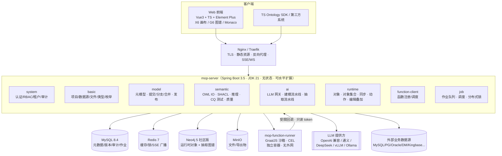
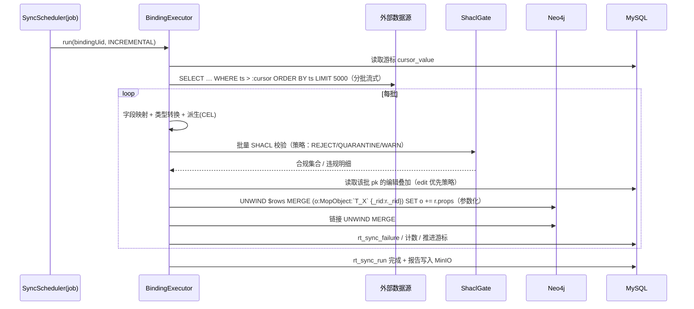
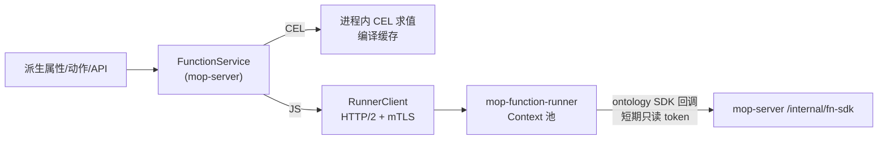
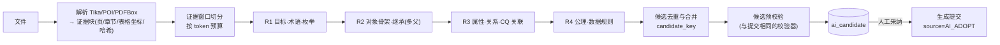

# 《沐曦本体平台专业版 技术开发文档》

| 项目 | 内容 |
|---|---|
| 文档编号 | MUXI-ONT-TD-001 |
| 版本 | v1.0（2026-11-14） |
| 编制 | 武汉沐曦云技术有限公司 · 架构组 |
| 关联文档 | 《qOntology 深度研究报告》MUXI-ONT-RS-001；《沐曦本体平台专业版 PRD》MUXI-ONT-PRD-001 |
| 代码仓库 | https://github.com/marcusmaomao/Muxi-Tech （公开，默认分支 `main`，当前只有 `LICENSE`(MIT) 和 `README.md`） |

> **开发红线**：本项目采用**净室实现**。禁止把 qOntology（江苏千桐科技，Apache-2.0 附加条款）的源码、SQL、提示词、前端组件或样式复制进本仓库。技术栈与 qOntology 保持兼容（Java + Spring Boot 3 + MyBatis-Plus + Vue 3 + Element Plus + MySQL + Neo4j + Redis），这样团队熟悉、部署形态接近；但所有实现都要自己写。每个 PR 模板中都要勾选“未复制第三方受限代码”。

---

## 1. 总体架构

### 1.1 逻辑架构



### 1.2 关键架构决策（ADR 摘要）

| ADR | 决策 | 理由 | 被否决的方案 |
|---|---|---|---|
| ADR-01 | 元数据（本体、版本）存放在 **MySQL 8**，采用“通用元素表 + JSON 负载 + 生成列索引” | 方便做通用的 diff、merge 和引用分析；与 qOntology 的 MySQL 栈兼容；5 万元素规模下 JSON 性能足够 | 每类元素一张表（diff/merge 代码量会成倍增长）；三元组库作为主存储（团队不熟、事务弱） |
| ADR-02 | 版本模型采用 **时态行（rev_start/rev_end）+ 分支覆盖层** | 建分支是 O(1)，不需要全表复制；能读任意提交的快照 | qOntology 式的全表复制（研究报告 §5.4） |
| ADR-03 | **稳定 IRI = 命名空间 + API 名**；元素 `uid` 是 ULID，跨版本不变 | 下游引用稳定 | 用自增 ID 拼 IRI |
| ADR-04 | 运行时对象存在 **Neo4j 5 社区版**；租户用 `_t` 属性加查询改写隔离 | 与 qOntology 一致，便于链接遍历；社区版免费 | 关系库存图（遍历性能差） |
| ADR-05 | 语义计算用 **Apache Jena**（RDF、SPARQL、SHACL、RL 规则）+ **OWLAPI 5 + ELK / HermiT** | 都是 Apache 或 LGPL 许可，成熟 | Openllet（AGPL，排除）；RDF4J（SHACL 能力可用，但团队选用 Jena 统一） |
| ADR-06 | 函数分两档：**CEL**（进程内，只做表达式）和 **GraalJS**（独立 runner 容器沙箱） | 表达式需要低延迟；脚本需要强隔离 | 进程内 Nashorn/Rhino（隔离不足） |
| ADR-07 | 所有 Cypher 都**参数化**；Label 和关系类型不能参数化，所以**只接受从已发布模型白名单查出的 API 名**，并加反引号转义 | 修复 qOntology 的注入隐患 | 字符串拼接 |
| ADR-08 | 跨库一致性用 **MySQL 本地事务（edits + audit + outbox）→ Neo4j 事务 → 状态回写**，失败时补偿 | 不引入分布式事务 | XA/Seata |
| ADR-09 | LLM 网关基于 **Spring AI 1.1**（ChatClient + 结构化输出），每个阶段可以配置模型 | 与 qOntology 技术相近；支持 OpenAI 兼容协议覆盖国产模型 | LangChain4j（也可行，团队统一选 Spring AI） |
| ADR-10 | JDK **21**（LTS） | GraalJS polyglot 24.x 需要 JDK 21+；可以用虚拟线程 | JDK 17（与 qOntology 一致，但 GraalJS 受限） |

---

## 2. 技术选型

| 层 | 选型 | 版本（基线） | 许可 | 说明 |
|---|---|---|---|---|
| 语言 | Java | 21 LTS | GPLv2+CPE | Temurin |
| 框架 | Spring Boot / Security / Validation / Actuator | 3.5.x | Apache-2.0 | 与 qOntology 同代 |
| ORM | MyBatis-Plus（含租户插件 `TenantLineInnerInterceptor`） | 3.5.x | Apache-2.0 | |
| 数据库迁移 | Flyway | 10.x | Apache-2.0 | 替代“初始化 SQL 大文件” |
| 元数据库 | MySQL | 8.4 LTS | GPL（服务端） | P1 适配达梦/金仓 |
| 图库 | Neo4j Community + Java Driver | 5.26 LTS | GPLv3（服务端）/ Apache（驱动） | 只通过驱动访问 |
| 缓存/锁 | Redis + Redisson | 7.4 / 3.x | BSD / Apache | 分布式锁、SSE 广播 |
| 对象存储 | MinIO（S3 协议） | latest | AGPL（服务端，独立部署不链接） | 也可以换成 OSS/OBS |
| RDF/SHACL | Apache Jena（ARQ、SHACL、规则引擎） | 5.x | Apache-2.0 | |
| OWL | OWLAPI 5.x、ELK 0.6.x、HermiT 1.4.5.x | — | LGPL/Apache；Apache；LGPL | HermiT 作为独立 jar 动态链接 |
| 表达式 | cel-java（`dev.cel`） | 0.x | Apache-2.0 | |
| 脚本沙箱 | GraalVM Polyglot + GraalJS（社区版） | 24.x | UPL | 运行在 function-runner 中 |
| LLM | Spring AI（OpenAI 兼容、Ollama）+ Spring AI Alibaba（DashScope，可选） | 1.1.x | Apache-2.0 | |
| 文档解析 | Apache Tika + POI + PDFBox | 3.x / 5.x / 3.x | Apache-2.0 | |
| API 文档 | springdoc-openapi | 2.x | Apache-2.0 | |
| 可观测 | Micrometer + Prometheus、OpenTelemetry | — | Apache-2.0 | |
| 前端 | Vue 3.5、TypeScript 5、Vite 6、Element Plus 2.x、Pinia 2、Vue Router 4、Axios 1、vue-i18n | — | MIT | |
| 画布 | **AntV X6 2.x**（+ stencil/dnd/history/selection/snapline/keyboard/clipboard/minimap/export/transform 插件）、ELK.js 布局 | 2.18+ | MIT / EPL-2.0 | 建模画布 |
| 图谱 | **AntV G6 5.x** | 5.x | MIT | 实例图谱探索 |
| 编辑器 | Monaco（SPARQL/Cypher/TTL/JS/CEL 语法） | 0.5x | MIT | |
| 图表 | ECharts 5 | 5.x | Apache-2.0 | 质量趋势 |
| 测试 | JUnit 5、AssertJ、Mockito、Testcontainers、ArchUnit、WireMock；Vitest、Vue Test Utils；**Playwright** | — | — | |
| CI/CD | GitHub Actions、GHCR、Traefik（预览环境） | — | — | |

---

## 3. 代码仓库与模块划分

```
Muxi-Tech/
├─ backend/                         # Maven 多模块（groupId: cn.muxicloud.mop）
│  ├─ mop-dependencies/            # BOM
│  ├─ mop-common/                  # 通用工具、错误码、ULID、JSON
│  ├─ mop-framework/
│  │  ├─ mop-fw-web/               # 统一响应、异常、TraceId、幂等
│  │  ├─ mop-fw-security/          # JWT、API Token、权限注解、@ProjectRole
│  │  ├─ mop-fw-tenant/            # TenantContext、MyBatis 租户插件、Neo4j 租户守卫
│  │  ├─ mop-fw-mybatis/           # MP 配置、审计字段填充
│  │  ├─ mop-fw-audit/             # 审计切面、哈希链
│  │  └─ mop-fw-job/               # 作业表、Worker、ShedLock/Redisson
│  ├─ mop-module-system/           # 用户/角色/菜单/部门/字典/参数/日志/租户
│  ├─ mop-module-basic/            # 项目、数据源、文件、平台类型与枚举
│  ├─ mop-module-model/            # 元模型、提交/分支/合并/发布、引用图、编译器
│  ├─ mop-module-semantic/         # OWL 导入导出、SHACL、推理、CQ 测试、质量中心
│  ├─ mop-module-ai/               # LLM 网关、建模流水线、抽取流水线、评测
│  ├─ mop-module-runtime/          # 对象、对象集合、同步、动作、编辑叠加、Outbox
│  ├─ mop-function-api/            # 函数协议 DTO（core 与 runner 共用）
│  ├─ mop-function-runner/         # 独立 Spring Boot 应用：GraalJS 沙箱
│  └─ mop-server/                  # 启动聚合、配置、Flyway 脚本
├─ frontend/                       # Vue3 + TS（pnpm）
│  ├─ src/{api,stores,router,layouts,components,views,canvas,graph,editors,i18n,utils}
│  └─ tests/unit/
├─ e2e/                            # Playwright（TS）
│  ├─ fixtures/ pages/ specs/ data/
├─ deploy/
│  ├─ compose/ (docker-compose.yml, .env.example, nginx/, seed/)
│  ├─ preview/ (traefik/, compose.preview.yml)
│  └─ demo/   (reset.sh, backup/)
├─ sdk/ts/                         # Ontology SDK 生成器（P1）
├─ docs/                           # 本文档 + ADR + API 手册
└─ .github/workflows/              # ci.yml preview.yml release.yml security.yml
```

模块依赖规则用 ArchUnit 强制检查：`runtime → model(只读发布快照)`，`semantic → model`，`ai → model, semantic`，**禁止反向依赖**；模块之间只通过 `*-api` 包中的接口调用。

---

## 4. 数据库设计（MySQL 8.4）

### 4.1 通用约定
- 所有业务表都有：`tenant_id BIGINT NOT NULL`、`created_by`、`created_at`、`updated_by`、`updated_at`、`deleted TINYINT DEFAULT 0`（逻辑删除，版本表除外）。
- 主键用 `BIGINT`（雪花算法）；对外标识用 `uid CHAR(26)`（ULID）。
- 字符集 `utf8mb4`，排序规则 `utf8mb4_0900_ai_ci`。
- 迁移脚本：`backend/mop-server/src/main/resources/db/migration/V{yyyyMMddHHmm}__desc.sql`。

### 4.2 元模型与版本（核心）

```sql
-- 项目
CREATE TABLE mop_project (
  id BIGINT PRIMARY KEY, tenant_id BIGINT NOT NULL,
  code VARCHAR(64) NOT NULL, name VARCHAR(128) NOT NULL, domain VARCHAR(128),
  namespace VARCHAR(255) NOT NULL,            -- 绝对 URI，以 # 或 / 结尾
  scope_include VARCHAR(1000), scope_exclude VARCHAR(1000), description VARCHAR(1000),
  require_cq_link TINYINT NOT NULL DEFAULT 1, -- 对象/关系必须挂 CQ
  default_branch_id BIGINT,
  created_by BIGINT, created_at DATETIME(3), updated_by BIGINT, updated_at DATETIME(3), deleted TINYINT DEFAULT 0,
  UNIQUE KEY uk_project_code (tenant_id, code)
);

-- 分支
CREATE TABLE mop_branch (
  id BIGINT PRIMARY KEY, tenant_id BIGINT NOT NULL, project_id BIGINT NOT NULL,
  name VARCHAR(128) NOT NULL,
  parent_branch_id BIGINT NULL,          -- 从哪个分支拉出
  fork_rev BIGINT NULL,                  -- 拉出时父分支的提交序号
  head_rev BIGINT NOT NULL DEFAULT 0,
  protected TINYINT NOT NULL DEFAULT 0,  -- main 默认受保护
  status VARCHAR(16) NOT NULL DEFAULT 'ACTIVE', -- ACTIVE/MERGED/ARCHIVED
  created_by BIGINT, created_at DATETIME(3),
  UNIQUE KEY uk_branch (project_id, name)
);

-- 提交（rev 为项目内全局单调递增序号）
CREATE TABLE mop_commit (
  id BIGINT PRIMARY KEY, tenant_id BIGINT NOT NULL, project_id BIGINT NOT NULL,
  branch_id BIGINT NOT NULL, rev BIGINT NOT NULL,
  parent_rev BIGINT NULL, merge_source_branch_id BIGINT NULL, merge_source_rev BIGINT NULL,
  message VARCHAR(500) NOT NULL, source VARCHAR(16) NOT NULL DEFAULT 'MANUAL', -- MANUAL/AI_ADOPT/MERGE/IMPORT/REVERT
  change_count INT NOT NULL DEFAULT 0, author_id BIGINT, created_at DATETIME(3),
  UNIQUE KEY uk_commit_rev (project_id, rev), KEY idx_commit_branch (branch_id, rev)
);

-- 元素时态行：一行 = 某个元素在某个分支上的一个版本区间
CREATE TABLE mop_element (
  id BIGINT PRIMARY KEY, tenant_id BIGINT NOT NULL, project_id BIGINT NOT NULL,
  branch_id BIGINT NOT NULL,
  uid CHAR(26) NOT NULL,                       -- 跨版本稳定
  element_type VARCHAR(32) NOT NULL,           -- OBJECT_TYPE/INTERFACE/PROPERTY/LINK_TYPE/AXIOM/DATA_RULE/SHAPE/TERM/
                                               -- DATA_TYPE/ENUM_TYPE/ENUM_VALUE/CQ/CQ_TEST/FIXTURE/ACTION_TYPE/FUNCTION/BINDING/VIEW
  api_name VARCHAR(128) NULL,                  -- 稳定 IRI 的 local name（同项目同类型唯一）
  owner_uid CHAR(26) NULL,                     -- 例如 PROPERTY 所属的 OBJECT_TYPE
  rev_start BIGINT NOT NULL, rev_end BIGINT NULL, -- [start, end)；NULL 表示该分支的当前版本
  tombstone TINYINT NOT NULL DEFAULT 0,        -- 在本分支被删除（覆盖父分支）
  payload JSON NOT NULL,                       -- 元素主体，按 element_type 的 JSON Schema 校验
  display_name VARCHAR(255) GENERATED ALWAYS AS (payload->>'$.displayName') STORED,
  content_hash CHAR(64) NOT NULL,              -- 规范化 payload 的 SHA-256，用于快速 diff
  KEY idx_el_branch_cur (branch_id, rev_end, element_type),
  KEY idx_el_uid (project_id, uid, branch_id, rev_start),
  KEY idx_el_api (project_id, branch_id, element_type, api_name),
  KEY idx_el_owner (branch_id, owner_uid)
);

-- 元素引用边（同样时态化）：继承、关系端点、属性类型、规则目标、动作参数类型、函数依赖等
CREATE TABLE mop_element_ref (
  id BIGINT PRIMARY KEY, tenant_id BIGINT NOT NULL, project_id BIGINT NOT NULL, branch_id BIGINT NOT NULL,
  from_uid CHAR(26) NOT NULL, to_uid CHAR(26) NOT NULL,
  ref_type VARCHAR(32) NOT NULL,   -- EXTENDS/IMPLEMENTS/LINK_SOURCE/LINK_TARGET/PROP_TYPE/ENUM_OF/RULE_TARGET/CQ_LINK/USES_FUNCTION/...
  ordinal INT NOT NULL DEFAULT 0,
  rev_start BIGINT NOT NULL, rev_end BIGINT NULL,
  KEY idx_ref_from (branch_id, rev_end, from_uid), KEY idx_ref_to (branch_id, rev_end, to_uid, ref_type)
);

-- 字段级变更明细（用于 diff 展示、审计、回滚）
CREATE TABLE mop_change (
  id BIGINT PRIMARY KEY, tenant_id BIGINT NOT NULL, project_id BIGINT NOT NULL,
  commit_id BIGINT NOT NULL, uid CHAR(26) NOT NULL, element_type VARCHAR(32) NOT NULL,
  op VARCHAR(8) NOT NULL,          -- ADD/MODIFY/DELETE
  before_json JSON NULL, after_json JSON NULL, field_paths JSON NULL,
  KEY idx_change_commit (commit_id)
);

-- 合并请求
CREATE TABLE mop_merge_request (
  id BIGINT PRIMARY KEY, tenant_id BIGINT NOT NULL, project_id BIGINT NOT NULL,
  source_branch_id BIGINT NOT NULL, target_branch_id BIGINT NOT NULL,
  base_rev BIGINT NOT NULL, source_rev BIGINT NOT NULL, target_rev BIGINT NOT NULL,
  title VARCHAR(200) NOT NULL, description TEXT, status VARCHAR(16) NOT NULL, -- OPEN/CONFLICT/APPROVED/MERGED/CLOSED
  quality_run_id BIGINT NULL, cq_run_id BIGINT NULL, conflicts JSON NULL, resolutions JSON NULL,
  created_by BIGINT, created_at DATETIME(3), merged_by BIGINT, merged_at DATETIME(3)
);
CREATE TABLE mop_mr_review (id BIGINT PRIMARY KEY, tenant_id BIGINT, mr_id BIGINT, reviewer_id BIGINT,
  decision VARCHAR(16), comment TEXT, element_uid CHAR(26) NULL, created_at DATETIME(3));

-- 发布版本（不可变；运行时绑定发布版本）
CREATE TABLE mop_release (
  id BIGINT PRIMARY KEY, tenant_id BIGINT NOT NULL, project_id BIGINT NOT NULL,
  version VARCHAR(32) NOT NULL, branch_id BIGINT NOT NULL, rev BIGINT NOT NULL,
  compiled_model JSON NOT NULL,      -- 编译后的运行时模型（类型、属性、链接、动作、函数引用、继承闭包）
  owl_object_key VARCHAR(255), shacl_object_key VARCHAR(255), -- MinIO 中的导出物
  quality_run_id BIGINT NOT NULL, cq_run_id BIGINT NOT NULL,
  status VARCHAR(16) NOT NULL DEFAULT 'PUBLISHED', -- PUBLISHED/DEPRECATED
  published_by BIGINT, published_at DATETIME(3),
  UNIQUE KEY uk_release (project_id, version)
);

-- 画布视图（布局不进入语义版本，但按分支保存）
CREATE TABLE mop_canvas_view (
  id BIGINT PRIMARY KEY, tenant_id BIGINT NOT NULL, project_id BIGINT NOT NULL, branch_id BIGINT NOT NULL,
  name VARCHAR(128) NOT NULL, filter JSON NULL, layout JSON NOT NULL, -- {uid:{x,y,collapsed}}
  updated_by BIGINT, updated_at DATETIME(3)
);
CREATE TABLE mop_edit_lock (tenant_id BIGINT, branch_id BIGINT, uid CHAR(26), user_id BIGINT,
  expires_at DATETIME(3), PRIMARY KEY (branch_id, uid));
```

**读取分支视图的算法**（`BranchReader`）：
1. 计算分支链 `B0(当前) → B1(父, 截止 fork_rev) → …`，深度上限 5，超过时要求先合并或变基。
2. 对每个 uid，取链上**第一个**存在“有效行”的分支：当前分支取 `rev_end IS NULL`；祖先分支取 `rev_start <= fork_rev AND (rev_end IS NULL OR rev_end > fork_rev)`。
3. 如果命中的是 `tombstone=1`，表示该元素在当前分支已被删除。
4. 读结果按 `(project, branch, head_rev)` 缓存到 Redis，有新提交时失效。

**写入（提交）**：同一事务内，对每个变更元素：把当前分支上的旧行 `rev_end = newRev`，插入新行 `rev_start = newRev`；如果元素来自祖先分支，第一次修改时直接在当前分支插入新行（写时复制）；同时写入 `mop_change`；`mop_branch.head_rev = newRev`；rev 由 `SELECT … FOR UPDATE` 锁住项目行后递增。

**Diff**：两侧各读出视图后按 uid 求差：比较 `content_hash`，hash 不同时再做 JSON 字段级 diff（RFC 6902 JSON Patch）。
**三方合并**：base = 公共祖先视图（源分支的 `fork_rev` 或上次合并点）。逐 uid 处理：只有一方改 → 采用该方；双方改了不同字段 → 字段级自动合并；双方改了同一字段且值不同 → 冲突；删除 vs 修改 → 冲突。合并后对结果执行引用完整性检查（悬空引用、继承环），再跑质量检查和 CQ 测试。

**多重继承**：`EXTENDS` 引用边可以有多条；用 DFS 检测环（提交时增量检测：只从被修改的节点出发）；发布编译时生成 **继承闭包**（`ancestors[]`、`descendants[]`）和**有效属性集合**（同名冲突时，要求子类显式 `override`，否则报错 `PROP_CONFLICT`）。

### 4.3 元素 payload 示例

```json
// OBJECT_TYPE
{"displayName":"变压器","apiName":"Transformer","description":"…","icon":"bolt","color":"#2F6BFF",
 "status":"ACTIVE","abstract":false,"primaryKey":["assetCode"],"titleProperty":"name",
 "cqUids":["01J…"],"termUids":["01J…"]}
// PROPERTY
{"displayName":"额定电压","apiName":"ratedVoltage","ownerUid":"01J…","valueType":{"kind":"BASIC","basic":"DECIMAL","unit":"kV","scale":2},
 "required":true,"minCount":1,"maxCount":1,"multiValued":false,"defaultValue":null,
 "derived":null}                       // 或 {"functionUid":"01J…","mode":"ON_READ"}
// LINK_TYPE
{"displayName":"安装于","apiName":"installedAt","sourceUid":"…","targetUid":"…","cardinality":"MANY_TO_ONE",
 "inverse":{"displayName":"安装设备","apiName":"hasEquipment"},"symmetric":false,"transitive":false}
// AXIOM
{"kind":"DISJOINT","classes":["uidA","uidB"],"level":"ERROR"}
// DATA_RULE（编译为 SHACL）
{"kind":"RANGE","target":{"objectType":"uid","property":"uid"},"min":0,"max":1000,"inclusive":true,"severity":"Violation","message":"额定电压超出范围"}
// ACTION_TYPE（见 §6.3）  FUNCTION（见 §6.4）  CQ_TEST（见 §7.4）
```

### 4.4 运行时与作业相关表

```sql
CREATE TABLE rt_binding_runtime (  -- 运行时状态（绑定定义本身在 mop_element 的 BINDING 中，随版本发布）
  id BIGINT PRIMARY KEY, tenant_id BIGINT, project_id BIGINT, release_id BIGINT, binding_uid CHAR(26),
  datasource_id BIGINT, cursor_value VARCHAR(255), last_sync_at DATETIME(3), status VARCHAR(16));
CREATE TABLE rt_sync_run (
  id BIGINT PRIMARY KEY, tenant_id BIGINT, binding_uid CHAR(26), mode VARCHAR(16), -- FULL/INCREMENTAL/PREVIEW
  started_at DATETIME(3), finished_at DATETIME(3), status VARCHAR(16),
  inserted INT, updated INT, deleted INT, failed INT, quarantined INT, report_key VARCHAR(255));
CREATE TABLE rt_sync_failure (id BIGINT PRIMARY KEY, run_id BIGINT, source_pk VARCHAR(255), reason_code VARCHAR(64), detail JSON);

CREATE TABLE rt_object_edit (      -- 编辑叠加层（动作产生）
  id BIGINT PRIMARY KEY, tenant_id BIGINT, object_type VARCHAR(128), pk VARCHAR(255), rid VARCHAR(255),
  op VARCHAR(8), props JSON, action_exec_id BIGINT, edit_seq BIGINT, created_at DATETIME(3),
  KEY idx_edit_obj (tenant_id, object_type, pk, edit_seq));

CREATE TABLE rt_action_execution (
  id BIGINT PRIMARY KEY, tenant_id BIGINT, release_id BIGINT, action_api_name VARCHAR(128),
  idempotency_key VARCHAR(128), params JSON, plan JSON, status VARCHAR(16), -- VALIDATING/PENDING/APPLIED/FAILED/COMPENSATED
  error_code VARCHAR(64), error_detail JSON, executed_by BIGINT, source VARCHAR(8), started_at DATETIME(3), finished_at DATETIME(3),
  UNIQUE KEY uk_idem (tenant_id, action_api_name, idempotency_key));
CREATE TABLE rt_outbox (
  id BIGINT PRIMARY KEY, tenant_id BIGINT, exec_id BIGINT, target_kind VARCHAR(16), -- DB/WEBHOOK/NOTIFY
  target_ref VARCHAR(255), payload JSON, status VARCHAR(16), attempts INT, next_attempt_at DATETIME(3), last_error TEXT);

CREATE TABLE sys_audit_log (       -- 只能追加；hash = SHA256(prev_hash || canonical(row))
  id BIGINT PRIMARY KEY, tenant_id BIGINT, actor_id BIGINT, actor_ip VARCHAR(64), category VARCHAR(32),
  action VARCHAR(64), target_type VARCHAR(64), target_id VARCHAR(255), detail JSON, result VARCHAR(16),
  trace_id VARCHAR(64), created_at DATETIME(3), prev_hash CHAR(64), hash CHAR(64));

CREATE TABLE sem_run (             -- 质量/SHACL/推理/CQ 运行记录
  id BIGINT PRIMARY KEY, tenant_id BIGINT, project_id BIGINT, branch_id BIGINT, rev BIGINT,
  kind VARCHAR(16), -- QUALITY/SHACL/REASON/CQ
  status VARCHAR(16), score DECIMAL(5,2) NULL, summary JSON, report_key VARCHAR(255), started_at DATETIME(3), finished_at DATETIME(3));
CREATE TABLE sem_issue (id BIGINT PRIMARY KEY, run_id BIGINT, check_code VARCHAR(64), severity VARCHAR(16),
  element_uid CHAR(26), focus_node VARCHAR(255), message VARCHAR(1000), state VARCHAR(16), ignore_reason VARCHAR(500));

CREATE TABLE ai_job (id BIGINT PRIMARY KEY, tenant_id BIGINT, project_id BIGINT, branch_id BIGINT,
  kind VARCHAR(16), -- MODELING/EXTRACTION/CQ_GEN
  status VARCHAR(16), stage VARCHAR(32), model_ref JSON, prompt_version VARCHAR(32), token_in INT, token_out INT,
  error TEXT, created_by BIGINT, created_at DATETIME(3), finished_at DATETIME(3));
CREATE TABLE ai_evidence (id BIGINT PRIMARY KEY, job_id BIGINT, file_id BIGINT, block_no INT, block_type VARCHAR(16),
  page_no INT, section_path VARCHAR(1000), table_ref JSON, content MEDIUMTEXT, content_hash CHAR(64));
CREATE TABLE ai_candidate (id BIGINT PRIMARY KEY, job_id BIGINT, candidate_key VARCHAR(255), element_type VARCHAR(32),
  payload JSON, evidence_block_nos JSON, confidence DECIMAL(5,4), state VARCHAR(16), -- PENDING/ADOPTED/REJECTED/FAILED
  adopted_uid CHAR(26), commit_id BIGINT, message VARCHAR(1000));
CREATE TABLE ai_extraction_item (id BIGINT PRIMARY KEY, job_id BIGINT, kind VARCHAR(8), -- ENTITY/LINK
  payload JSON, evidence JSON, confidence DECIMAL(5,4), validation JSON, state VARCHAR(16), -- QUARANTINE/REVIEW/ACCEPTED/REJECTED/PUBLISHED
  resolved_rid VARCHAR(255));

CREATE TABLE job_queue (id BIGINT PRIMARY KEY, tenant_id BIGINT, type VARCHAR(32), ref_id BIGINT, priority INT,
  status VARCHAR(16), attempts INT, locked_by VARCHAR(64), locked_until DATETIME(3), payload JSON, created_at DATETIME(3));
```

系统管理表（`sys_user`、`sys_role`、`sys_menu`、`sys_dept`、`sys_post`、`sys_dict_*`、`sys_config`、`sys_notice`、`sys_login_log`、`sys_oper_log`、`sys_tenant`、`sys_project_member(project_id,user_id,role)`）按常规 RBAC 设计，这里不展开。

### 4.5 图库模型（Neo4j 5）

```
(:MopObject:`T_<ObjectTypeApiName>` {
   _rid: "ri.mop.<tenant>.object.<Type>.<pk>",   // 唯一约束
   _t: <tenantId>, _type: "<Type>", _pk: "<pk>", _release: <releaseId>,
   _src: "SYNC|ACTION|EXTRACT", _edited: bool, _updatedAt: datetime,
   <propertyApiName>: <typed value> ... })
-[:`L_<LinkApiName>` {_t, _src, _createdAt}]->

(:MopExtract { _t, _job, _type, name, _conf, _state: "REVIEW|PUBLISHED", _evidence: [...] })   // 抽取候选区，与正式对象分开
```

- 约束和索引：`CREATE CONSTRAINT mop_rid IF NOT EXISTS FOR (n:MopObject) REQUIRE n._rid IS UNIQUE`；每个 `T_*` 标签在 `(_t, _pk)` 上建复合索引（社区版支持复合索引，但不支持 node key）。属性索引根据对象类型配置的“可检索属性”自动创建或删除（发布时 diff 出来）。
- **租户守卫**：`TenantAwareCypher` 只接受内部构造的 AST（cypher-dsl），所有 `MATCH` 节点都会自动追加 `_t = $tenant`；Label 和关系类型只能来自 `CompiledModel` 白名单，并用反引号转义。
- 推理产生的类型：`_inferredTypes: [...]` 属性（RL 物化），与断言类型分开。

### 4.6 RDF 投影（语义计算时使用，不持久化）

`IRI(object) = <namespace>obj/<Type>/<urlencode(pk)>`；类 `<namespace><TypeApiName>`；属性 `<namespace><prop>`；链接 `<namespace><link>`。`RdfProjector` 按对象集合流式把对象转成 Jena `Graph`，每批 1 万个节点，供 SHACL、SPARQL 和 RL 推理使用。

---

## 5. API 设计

统一约定：前缀 `/api/v1`；认证头 `Authorization: Bearer <JWT|API-Token>`；租户从令牌中解析；分页参数 `page/size`（size ≤ 200）；错误响应：`{ "code":"MOP-xxxx", "message":"…", "details":{…}, "traceId":"…" }`；写接口支持 `Idempotency-Key`；长任务返回 `202 + jobId`，进度通过 SSE `GET /api/v1/jobs/{id}/events` 推送。

### 5.1 主要接口清单

| 域 | 方法与路径 | 说明 | 优先级 |
|---|---|---|---|
| 认证 | `POST /auth/login`、`POST /auth/refresh`、`POST /auth/logout`、`GET /auth/captcha`、`GET /auth/me` | 登录与当前用户（含菜单和权限） | P0 |
| 租户 | `GET/POST/PUT/DELETE /tenants`、`POST /tenants/{id}/demo-seed` | 租户管理、演示数据 | P0 |
| 系统 | `/system/users`、`/roles`、`/menus`、`/depts`、`/posts`、`/dicts`、`/configs`、`/notices`、`/logs/oper`、`/logs/login`、`/audit` | RBAC 与日志 | P0 |
| 项目 | `GET/POST/PUT/DELETE /projects`、`GET/PUT /projects/{id}/members` | 项目与项目角色 | P0 |
| 数据源 | `GET/POST/PUT/DELETE /datasources`、`POST /datasources/{id}/test`、`GET /datasources/{id}/tables`、`GET /datasources/{id}/tables/{t}/columns` | 数据源与元数据浏览 | P0 |
| 文件 | `POST /files`（multipart）、`GET /files`、`GET /files/{id}/preview`、`GET /files/{id}/text` | 文件 | P0 |
| 分支 | `GET/POST /projects/{pid}/branches`、`DELETE /branches/{bid}`、`PUT /branches/{bid}/protect` | 分支 | P0 |
| 元素 | `GET /branches/{bid}/elements?type=&q=&ownerUid=`、`GET /branches/{bid}/elements/{uid}`、`GET /branches/{bid}/elements/{uid}/effective`（含继承属性） | 读取 | P0 |
| 变更 | `POST /branches/{bid}/commits`（body：`{message, changes:[{op, uid?, type, payload}]}`，原子提交）、`GET /branches/{bid}/commits`、`GET /commits/{id}`、`POST /branches/{bid}/revert/{rev}` | 写入与提交 | P0 |
| 便捷写入 | `POST/PUT/DELETE /branches/{bid}/object-types`、`/properties`、`/link-types`、`/axioms`、`/data-rules`、`/terms`、`/cqs`、`/enums`、`/data-types` | 表单视图使用，内部转换为单条提交 | P0 |
| 校验 | `POST /branches/{bid}/validate`（dry-run 变更集）、`GET /branches/{bid}/elements/{uid}/references` | 引用和影响分析 | P0 |
| 差异 | `GET /projects/{pid}/diff?from=branch:main@120&to=branch:feat` | 元素级和字段级 diff | P0 |
| 合并 | `POST /projects/{pid}/merge-requests`、`GET /merge-requests/{id}`、`POST /merge-requests/{id}/reviews`、`POST /merge-requests/{id}/resolve`、`POST /merge-requests/{id}/merge` | 合并请求 | P0 |
| 发布 | `POST /branches/{bid}/releases`（触发门禁）、`GET /projects/{pid}/releases`、`GET /releases/{id}/compiled-model` | 发布 | P0 |
| 画布 | `GET/POST/PUT /branches/{bid}/canvas-views`、`POST /branches/{bid}/locks/{uid}`、`DELETE …/locks/{uid}`、WS `/ws/branches/{bid}` | 画布与协同 | P0/P1 |
| 导入导出 | `GET /branches/{bid}/export?format=ttl|rdfxml|jsonld&shapes=true`、`POST /branches/{bid}/import`（202） | OWL/SHACL | P0/P1 |
| SHACL | `GET /branches/{bid}/shapes`（编译结果）、`POST /shacl/validate`（`{releaseId, objectSet | jobId}`，202）、`GET /sem-runs/{id}/report` | 校验 | P0 |
| 推理 | `POST /branches/{bid}/reason`（`{reasoner:"ELK|HERMIT|RL"}`，202）、`GET /sem-runs/{id}` | 推理 | P0 |
| CQ 测试 | `GET/POST/PUT/DELETE /branches/{bid}/cqs/{cqUid}/tests`、`POST /branches/{bid}/cq-runs`、`GET /cq-runs/{id}`、`POST /cqs/{cqUid}/generate-query`（AI） | CQ | P0/P1 |
| 质量 | `POST /branches/{bid}/quality-runs`、`GET /quality-runs/{id}`、`GET /projects/{pid}/quality/trend`、`PUT /sem-issues/{id}` | 质量中心 | P0 |
| AI 建模 | `POST /ai/modeling-jobs`、`GET /ai/jobs/{id}`、SSE `/ai/jobs/{id}/events`、`POST /ai/jobs/{id}/resume`、`GET /ai/jobs/{id}/candidates`、`POST /ai/candidates/{id}/adopt`、`POST /ai/jobs/{id}/adopt-all`、`POST /ai/candidates/{id}/reject`、`GET /ai/candidates/{id}/evidence` | AI 建模 | P0 |
| AI 抽取 | `POST /ai/extraction-jobs`（`{releaseId, fileIds, policy}`）、`GET /ai/jobs/{id}/items?state=`、`POST /ai/extraction-items/review`（批量通过或驳回）、`POST /ai/jobs/{id}/publish` | 抽取 | P0 |
| 模型市场 | `GET/POST/PUT/DELETE /ai/providers`、`/ai/models`、`POST /ai/models/{id}/test` | LLM 配置 | P0 |
| 绑定与同步 | `GET/PUT /branches/{bid}/bindings/{objectType}`、`POST /bindings/{uid}/preview`（返回前 N 条，不入库）、`POST /bindings/{uid}/sync`（`{mode}`）、`GET /sync-runs/{id}` | 数据源绑定 | P0 |
| 对象 | `GET /objects/{type}/{pk}`、`GET /objects/{type}?filter=…`、`GET /objects/{type}/{pk}/links/{link}`、`GET /objects/{type}/{pk}/history` | 对象 | P0 |
| 对象集合 | `POST /object-sets/query`、`POST /object-sets/aggregate`、`GET/POST/PUT/DELETE /object-sets/saved` | 对象集合 | P0/P1 |
| 动作 | `GET /actions?objectType=`、`POST /actions/{api}/validate`（dry-run）、`POST /actions/{api}/apply`、`POST /actions/{api}/apply-batch`、`GET /action-executions/{id}`、`POST /outbox/{id}/replay` | 动作 | P0/P1 |
| 函数 | `GET /functions`、`POST /functions/{api}/execute`、`POST /branches/{bid}/functions/{uid}/test-run`、`GET /functions/{api}/metrics` | 函数 | P0/P1 |
| 作业 | `GET /jobs/{id}`、SSE `/jobs/{id}/events`、`POST /jobs/{id}/cancel` | 通用作业 | P0 |
| SPARQL | `POST /releases/{id}/sparql`（只读，ASK/SELECT/CONSTRUCT） | 开放查询 | P1 |

### 5.2 对象集合 DSL（示例）

```json
{
  "release": "supply-chain@1.2.0",
  "objectSet": {
    "type": "searchAround",
    "link": "hasDefect",
    "objectSet": {
      "type": "filter",
      "objectSet": {"type": "base", "objectType": "Transformer", "includeSubtypes": true},
      "where": {"and": [
        {"eq": {"field": "status", "value": "运行"}},
        {"gte": {"field": "ratedVoltage", "value": 220}}
      ]}
    }
  },
  "then": {"filter": {"eq": {"field": "level", "value": "重大"}}},
  "select": ["defectNo", "level", "foundAt"],
  "orderBy": [{"field": "foundAt", "dir": "desc"}],
  "page": {"size": 50, "cursor": null}
}
```

编译器 `ObjectSetCompiler` 先用 `CompiledModel` 校验字段、链接和类型，再生成参数化 Cypher（cypher-dsl）；`includeSubtypes` 展开为后代类型标签的并集（来自推理分类或继承闭包）。

---

## 6. 引擎设计

### 6.1 元模型编译器（ModelCompiler）
输入：分支视图（或提交快照）。输出：`CompiledModel`（JSON，写入 `mop_release.compiled_model`，并缓存在 Redis）。
步骤：① JSON Schema 校验；② 引用解析（悬空引用报错）；③ 继承闭包和有效属性计算（多继承冲突检测）；④ 关系基数和逆关系规范化；⑤ 生成 `OwlModel`（OWLAPI 对象）和 `ShapesGraph`（Jena Graph）；⑥ 动作和函数签名校验（参数类型存在、函数版本存在）；⑦ 生成 Neo4j 索引计划。所有错误以 `sem_issue` 形式返回。

### 6.2 运行时对象引擎



- **流式与内存**：分批游标读取（JDBC `fetchSize`），每批 ≤ 5000 条，不在内存中堆积全量（修正研究报告 §5.3 提到的问题）。
- **删除检测**：全量模式下对比快照（用 pk 集合的布隆过滤器或临时表），增量模式依赖软删字段（可配置）。
- **样例预览**：`mode=PREVIEW` 只执行前 N 条的映射和校验，结果直接返回，不写入 Neo4j。
- **读路径**：`ObjectService.get()` 先从 Neo4j 读取，再叠加派生属性（ON_READ 函数，批量调用 CEL，脚本函数走 runner），最后按属性级权限做脱敏。

### 6.3 动作引擎

动作类型 payload：
```json
{"apiName":"registerDefect","displayName":"登记缺陷","appliesTo":"Equipment",
 "parameters":[
   {"name":"equipment","type":{"kind":"OBJECT","objectType":"Equipment"},"required":true,"default":"$context.object"},
   {"name":"level","type":{"kind":"ENUM","enum":"DefectLevel"},"required":true},
   {"name":"desc","type":{"kind":"STRING","maxLength":2000},"required":true}],
 "submissionCriteria":[
   {"kind":"CEL","expr":"params.equipment.status != '退役'","message":"退役设备不能登记缺陷"},
   {"kind":"ROLE","anyOf":["运检班长","运检员"]}],
 "rules":[
   {"op":"CREATE_OBJECT","objectType":"Defect","pk":"$fn.genDefectNo()","props":{"level":"$params.level","description":"$params.desc","foundAt":"$now"}},
   {"op":"CREATE_LINK","link":"hasDefect","from":"$params.equipment","to":"$created[0]"}],
 "sideEffects":[{"kind":"WRITEBACK","target":"datasource:pms","table":"t_defect","mapping":{"defect_no":"$created[0].pk"}}],
 "permissions":{"visibleTo":["role:运检员"],"executableBy":["role:运检班长","role:运检员"]},
 "audit":{"captureSnapshots":true}}
```

执行流程：
1. **授权**：动作级（executableBy）→ 对象级条件 → 项目角色。
2. **参数解析**：类型转换，对象引用加载（带租户守卫），默认值求值。
3. **校验**：参数约束 → `submissionCriteria`（CEL 在进程内执行，函数校验走 runner）→ 可选的受影响对象 SHACL 预校验。
4. **规划**：执行 rules 或编辑函数，生成 `EditPlan`（create/update/delete/link/unlink 列表），这一步纯计算、不落库（`/validate` 到这里就结束，返回 plan）。
5. **提交**：
   - MySQL 事务：插入 `rt_action_execution(PENDING)`、`rt_object_edit`、`sys_audit_log`、`rt_outbox`（如果有副作用）；
   - Neo4j 事务：按 plan 参数化写入，带 `_edited=true`；
   - 成功后 execution 更新为 `APPLIED`；Neo4j 失败时更新为 `FAILED`，并删除本次 edits 和 outbox（补偿），审计记录失败原因。
6. **副作用**：`OutboxDispatcher`（作业）按指数退避重试（1m、5m、30m），3 次失败进入 `DEAD`，可以手动重放。
7. **幂等**：`uk_idem` 唯一键；重复请求直接返回首次执行的结果。

### 6.4 函数引擎



- **CEL**：`dev.cel` 编译后缓存（key = 函数 uid + 版本）；变量 `self`（对象）、`params`、`links.<name>`（惰性对象集合，只允许 `size()/exists()/all()/sum()` 等聚合宏），一次求值上限 1 万步（cost limit）。
- **GraalJS runner**：
  - `Context.newBuilder("js").sandbox(SandboxPolicy.CONSTRAINED).allowHostAccess(HostAccess.NONE).allowIO(IOAccess.NONE).allowCreateThread(false).allowNativeAccess(false).allowEnvironmentAccess(EnvironmentAccess.NONE).option("js.ecmascript-version","2023")`（社区版支持 CONSTRAINED 策略；更严格的 ISOLATED/UNTRUSTED 需要 Oracle GraalVM，作为可选增强）；
  - 资源限制：`ResourceLimits.statementLimit`（防死循环）+ 看门狗线程在超时（默认 2 s）后调用 `context.close(true)`；容器层面 `--memory=512m --cpus=1 --network=mop_fn_internal`（只能访问 core 的内部端口）；
  - SDK 注入：只暴露 `ontology.objects(type).where(...).fetch()`、`ontology.get(type, pk)`、`ontology.aggregate(...)` 这样的代理对象（`ProxyObject`），内部回调 core；token 为短期、只读、租户受限；
  - 编辑函数返回 `{edits:[…]}`，由动作引擎校验后提交；
  - 输入输出按签名进行 JSON 序列化，输出 ≤ 1 MB。
- **版本**：函数发布时编译并做冒烟测试（运行其单元测试用例），记录 `codeHash`，运行时按 `(uid, version)` 加载。

### 6.5 SHACL 集成
- **编译**（`ShapeCompiler`）：PROPERTY → `sh:property [ sh:path ex:p; sh:datatype xsd:decimal; sh:minCount 1; sh:maxCount 1; sh:minInclusive 0; sh:maxInclusive 1000 ]`；ENUM → `sh:in (…)`；LINK → `sh:class ex:Target` + 基数；DATA_RULE（AND/OR 条件）→ `sh:and/sh:or` 或 SHACL-SPARQL `sh:sparql`；自定义 SHAPE 元素原样合并（先做 Turtle 语法校验）。
- **执行**：`org.apache.jena.shacl.ShaclValidator.get().validate(shapes, dataGraph)`；数据图来自 `RdfProjector`（按 targetClass 分批），报告转换为 `sem_issue`（focusNode → RID）。
- **一致性对照**：CI 中用 pySHACL 对同一份 `shapes.ttl` 和数据做对照校验（AC-SH-1）。
- **入图门禁**：同步和抽取在入图前调用 `ShaclGate.check(batch)`。

### 6.6 推理集成
- **模型层**：`OwlModel`（OWLAPI）→ `ElkReasonerFactory` 做分类，得到 `unsatisfiableClasses`；HermiT（`org.semanticweb.HermiT.ReasonerFactory`）只在用户勾选“完整一致性检查”或发布门禁配置为 DL 时异步执行，超时 120 s 后降级。解释功能（P1）使用 OWLAPI 的 `explanation` 工具生成导致不一致的最小公理集。
- **实例层（P1）**：Jena `GenericRuleReasoner` 加载 OWL RL 子集规则（subClassOf 传播、inverseOf、symmetric、transitive、domain/range 类型推断），对对象集合投影做前向链推理，把推断出的类型和链接写回 Neo4j，并标记 `_inferred`。
- **门禁**：存在不可满足类，或推理不一致 → `QUALITY.SEMANTIC` 维度判定失败 → 不允许发布。

### 6.7 质量中心
`QualityCheck` SPI：`code()`、`dimension()`（STRUCTURE/SEMANTIC/CONSTRAINT/GOAL）、`run(ctx) → List<Issue>`。内置检查：`STR_CYCLE`、`STR_DANGLING`、`STR_DUP_APINAME`、`STR_ORPHAN_CLASS`、`STR_NO_CQ`、`STR_NAMING`、`STR_NO_DESC`、`SEM_UNSAT`、`SEM_INCONSISTENT`、`CON_SHACL_COMPILE`、`CON_VIOLATION_RATE`、`GOAL_CQ_PASS`、`GOAL_ELEMENT_COVERAGE`。
评分：维度分 = 100 − Σ(扣分权重 × 问题数，有上限)；总分 = Σ(维度权重 × 维度分)；所有数字都追溯到 `sem_run.id`。

---

## 7. AI 建模与抽取流水线

### 7.1 LLM 网关
- `LlmGateway.chat(ModelRef, messages, ResponseSchema, options)`：基于 Spring AI 的 `ChatClient`；OpenAI 兼容协议覆盖通义（DashScope 兼容模式）、DeepSeek、vLLM、Ollama；结构化输出优先用 `response_format=json_schema`，模型不支持时退化为 `json_object` + 本地 JSON Schema 校验。
- 治理：每个租户单独限流和配额（令牌桶，Redis）；超时、重试（指数退避）、熔断（Resilience4j）；记录 token 和耗时；密钥用 AES-GCM 加密存储。
- 模型路由：`ai_job.model_ref` 可以按阶段覆盖（例如解析阶段用小模型，第 3 轮用大模型）。

### 7.2 建模流水线（MODELING）


- 每一轮的输入 = 当前窗口证据 + 前序候选索引（只用于去重，不作为事实来源）。
- 失败处理：JSON 校验失败 → 修复提示词重试 1 次 → 窗口二分 → 记录失败窗口；整个任务可以续跑（按窗口级 checkpoint）。
- 提示词：沐曦自主编写，存放在 `backend/mop-module-ai/src/main/resources/prompts/v{n}/`，用版本号管理；**不得参考或复制 qOntology 的提示词文本**。

### 7.3 抽取流水线（EXTRACTION）
1. 选择**发布版本** → `ExtractionSchemaBuilder` 直接从 `CompiledModel` 生成精简 schema（类、属性、链接、domain/range、枚举值、描述），不解析 TTL。
2. 文档切分（按语义段落，上限 N tokens，相邻段有重叠）→ LLM（JSON Schema 输出：`entities[{type, name, props, evidenceSpan, confidence}]`、`links[{type, from, to, evidenceSpan, confidence}]`）。
3. **后端校验**（`ExtractionValidator`）：类型和链接存在；属性存在且类型可以转换；domain/range 满足（考虑继承）；枚举值合法；名称做白名单字符处理；再经过 SHACL Gate。结果分为 `ACCEPTED_CANDIDATE` 和 `QUARANTINE`（附原因代码）。
4. **实体消解**：同一任务内按 `(type, normalize(name), pk 属性)` 合并；P1 用 embedding 相似度给出合并建议。
5. 审核队列：置信度 ≥ 阈值且策略为 AUTO 的直接 `ACCEPTED`；否则进入 `REVIEW`。
6. 发布：通过的条目写入 `MopExtract`（候选图），或“晋升”为 `MopObject`（需要对象类型配置主键规则）。
7. 评测（P1）：`ai_eval_set`（人工标注）→ 计算 P/R/F1，记录在提示词版本和模型维度上。

### 7.4 CQ 测试执行器
CQ_TEST payload：`{"language":"SPARQL|CYPHER","layer":"TBOX|ABOX","query":"…","fixtureUid":"…","assert":{"kind":"COUNT","op":">=","value":1}}`。
- SPARQL：在 Jena 内存数据集（T-Box = OWL 导出；A-Box = 夹具 TTL 或对象集合投影）上执行，超时 10 s。
- Cypher：只允许读语句（用 cypher-dsl 解析器拒绝 CREATE/MERGE/SET/DELETE/CALL 写过程）；夹具模式下写入临时租户 `_t = -runId`，执行后清理；实时数据模式下强制注入租户条件。
- AI 生成查询（P1）：输入 CQ 文本 + 精简 schema，输出查询 + 引用的元素列表，由人确认。

---

## 8. 前端架构

### 8.1 技术与结构
- Vue 3.5 + TypeScript + Vite 6 + Element Plus + Pinia + Vue Router + vue-i18n；Axios 封装（自动刷新令牌、带 `Idempotency-Key`、透传 traceId）。
- 目录：`views/`（页面）、`canvas/`（X6 封装）、`graph/`（G6 封装）、`editors/`（Monaco 语言包：Turtle、SPARQL、Cypher、CEL）、`components/`（ElementForm、DiffViewer、EvidenceViewer、ObjectSetBuilder、ActionForm）、`stores/`（auth、tenant、project、branch、model）。
- 设计规范：沐曦自有的视觉规范（主色、图标、布局），**不参考 qOntology 的页面布局和交互**（外观专利风险）。

### 8.2 页面地图（P0）
登录 → 工作台（项目卡片、最近活动）→ 项目：概览 | 建模（**画布** / 表单 / 树）| 语义资产（术语、类型、枚举）| CQ 与测试 | 约束（公理、规则、Shapes）| AI 建模 | 版本（提交、分支、差异、合并请求、发布）| 质量中心 | 数据绑定与同步 | 对象浏览器 | 动作与函数 | 抽取与审核 | 图谱探索 → 系统管理 / 租户管理。

### 8.3 建模画布（AntV X6）
- **节点**：用 Vue 组件节点（`@antv/x6-vue-shape`）渲染 `ObjectTypeNode`（标题栏 + 属性列表 + 端口）。由于 Vue shape 依赖 foreignObject，在 500 个节点以上时自动切换为纯 SVG 的简化节点（只显示标题），以保证性能。
- **边**：`LinkEdge`（关系，带基数标签）、`ExtendsEdge`（空心三角箭头，允许多条）、`ImplementsEdge`（虚线）；连线校验 `validateConnection`（禁止自继承，实时检测环）。
- **插件**：Stencil（拖入元素）、Dnd、Selection（框选）、Snapline、History（撤销/重做，与提交解耦：画布操作先进入本地“暂存变更集”，点击“提交”或开启自动提交（每 N 秒合并一次）时调用 `POST /commits`）、Keyboard、Clipboard、MiniMap、Export（PNG/SVG）、Transform。
- **布局**：ELK.js（`layered`，在 Web Worker 中运行），结果写入 `mop_canvas_view.layout`。
- **同步模型**：`modelStore`（以 uid 为键的规范化状态）是唯一数据源，画布和表单都订阅它；服务端推送（WS）的远端提交以增量补丁合并，冲突时提示刷新。
- **可测试性**：每个节点和边的 DOM 都带 `data-testid="node-<apiName>"`、`data-uid`，供 Playwright 定位。

### 8.4 图谱探索（AntV G6 5）
使用 WebGL 渲染器（`@antv/g-webgl`）处理大图；按需展开邻居（调用 `/objects/{type}/{pk}/links`）；节点样式按对象类型配置的颜色和图标；侧栏展示属性、动作按钮、证据。

---

## 9. 部署方案

### 9.1 本地（Docker Compose）

`deploy/compose/docker-compose.yml`（节选）：
```yaml
name: mop
services:
  mysql:
    image: mysql:8.4
    environment: { MYSQL_ROOT_PASSWORD: "${MYSQL_ROOT_PASSWORD}", MYSQL_DATABASE: mop }
    volumes: [ "mysql-data:/var/lib/mysql" ]
    healthcheck: { test: ["CMD","mysqladmin","ping","-h","localhost"], interval: 10s, retries: 10 }
  redis:
    image: redis:7.4-alpine
  neo4j:
    image: neo4j:5.26-community
    environment: { NEO4J_AUTH: "neo4j/${NEO4J_PASSWORD}", NEO4J_server_memory_heap_max__size: "1G" }
    volumes: [ "neo4j-data:/data" ]
  minio:
    image: minio/minio:latest
    command: server /data --console-address ":9001"
    environment: { MINIO_ROOT_USER: "${MINIO_USER}", MINIO_ROOT_PASSWORD: "${MINIO_PASSWORD}" }
    volumes: [ "minio-data:/data" ]
  mop-server:
    image: ghcr.io/marcusmaomao/mop-server:${MOP_TAG:-dev}
    env_file: .env
    depends_on: { mysql: { condition: service_healthy }, redis: { condition: service_started }, neo4j: { condition: service_started } }
    healthcheck: { test: ["CMD","curl","-f","http://localhost:8080/actuator/health"], interval: 15s, retries: 20 }
  mop-function-runner:
    image: ghcr.io/marcusmaomao/mop-function-runner:${MOP_TAG:-dev}
    networks: [ fn_internal ]           # 只与 mop-server 互通，无外网
    deploy: { resources: { limits: { cpus: "1.0", memory: 768M } } }
  web:
    image: ghcr.io/marcusmaomao/mop-web:${MOP_TAG:-dev}   # nginx + 前端 dist + 反代 /api /ws /sse
    ports: [ "8899:80" ]
    depends_on: [ mop-server ]
  llm-mock:                              # E2E 与离线演示用的可复现 LLM（WireMock 回放）
    image: wiremock/wiremock:3.9.1
    profiles: [ "test" ]
    volumes: [ "./llm-mock:/home/wiremock" ]
  ollama:
    image: ollama/ollama:latest
    profiles: [ "local-llm" ]
networks: { default: {}, fn_internal: { internal: true } }
volumes: { mysql-data: {}, neo4j-data: {}, minio-data: {} }
```
- 一键启动：`cp .env.example .env && docker compose up -d`，访问 `http://localhost:8899`，默认管理员和演示租户由 `mop-server` 启动时执行 `DemoSeeder` 初始化（受环境变量 `MOP_DEMO_SEED=true` 控制）。
- 开发模式：`docker compose up -d mysql redis neo4j minio` + IDE 启动后端 + `pnpm dev`。
- 多架构镜像：`linux/amd64,linux/arm64`（适配鲲鹏）。

### 9.2 远程演示环境
- **规格**：1 台云主机，8 vCPU / 32 GB / 200 GB SSD（华中或华东区域），Ubuntu 24.04 LTS 或麒麟 V10，Docker 27+。
- **入口**：Traefik v3（自动签发 Let’s Encrypt 证书，或使用企业证书）；`demo.<域名>` → 正式演示；`pr-<n>.preview.<域名>` → PR 预览（通配符 DNS `*.preview.<域名>`）。**域名待定（未核实），需要 ICP 备案。**
- **演示数据**：沐曦自主编写的三套行业演示数据（电网设备运检、轨交设备维修、水利工程设计规范），不使用 qOntology 的种子数据；每天 03:00（UTC+8）执行 `deploy/demo/reset.sh` 还原快照；演示账号只读或受限写（动作可执行，系统设置不可改）。
- **LLM**：演示环境默认接入一个低成本的云模型（密钥放在服务器的 `.env` 中，按天限额）；网络不可用时降级到 `llm-mock` 回放模式。
- **监控**：Prometheus + Grafana（可选，独立 compose profile）+ Uptime 探测。
- **备份**：每天备份 MySQL（mysqldump）、Neo4j（`neo4j-admin database dump`，需要短暂停服或使用在线备份方案）、MinIO（mc mirror）到对象存储，保留 7 天。

### 9.3 PR 预览环境
- 同一台或独立的预览主机；每个 PR 一个 compose project：`docker compose -p pr-<n> -f compose.yml -f compose.preview.yml up -d`；compose.preview.yml 添加 Traefik labels（`Host(pr-<n>.preview.<域名>)`）和更小的资源配额（Neo4j heap 512 MB，MySQL buffer pool 256 MB）。
- 同时最多保留 5 个预览，超出时按最近更新时间淘汰；PR 关闭后自动销毁（包括数据卷）。
- 预览环境开启 `llm-mock`，避免消耗真实额度。

---

## 10. 测试策略

### 10.1 测试金字塔与门槛

| 层级 | 工具 | 范围 | 门槛 |
|---|---|---|---|
| 单元 | JUnit 5 + AssertJ + Mockito；Vitest + Vue Test Utils | 编译器、diff/merge、CEL、ObjectSet 编译、SHACL 编译、校验器、前端 store 和组件 | 后端行覆盖率 ≥ 70%（model/semantic/runtime 核心包 ≥ 85%）；前端 ≥ 60% |
| 架构 | ArchUnit | 模块依赖方向、禁止直接拼接 Cypher（规则：禁止在 `Session.run(String)` 中使用非常量字符串） | 100% |
| 集成 | Spring Boot Test + **Testcontainers**（MySQL 8.4、Neo4j 5、Redis 7、MinIO）+ WireMock（LLM、Webhook） | 仓储、提交和分支、同步、动作事务与补偿、Outbox、SHACL/推理、租户隔离 | 核心用例全部通过 |
| 契约 | springdoc 生成 OpenAPI → `openapi-diff`（检测破坏性变更） | API 兼容性 | 主干上禁止未声明的破坏性变更 |
| 语义一致性 | pySHACL 与 Jena 对照；rdflib 解析导出物；ELK 与 HermiT 分类结果对照（小样本） | 标准合规 | 100% 一致 |
| 安全 | 越权测试集（跨租户、跨项目、角色）、Cypher/SQL 注入用例、函数沙箱逃逸用例、gitleaks、CodeQL、依赖漏洞扫描 | — | 高危漏洞为 0 |
| 性能 | k6（API）、Playwright 性能采样（画布 FPS）、JMH（编译器和 diff） | §5 非功能指标 | 达标 |
| **端到端** | **Playwright（TypeScript）** | 用户主流程 | P0 场景 100% 通过，失败时保留 trace 和视频 |
| AI 评测 | 离线评测集（每晚，真实模型） | 建模采纳率、抽取 F1 | 回归下降 ≤ 3% |

### 10.2 Playwright 设计
- 运行环境：CI 中执行 `docker compose --profile test up -d`（使用 `llm-mock`，保证结果可复现）；本地可以指向任意 `BASE_URL`（例如预览环境）。
- 结构：`e2e/fixtures/auth.ts`（通过 API 登录，生成 `storageState`，按角色区分：admin/architect/expert/operator/viewer）、`e2e/pages/*`（Page Object）、`e2e/data/*`（演示行业数据、夹具 TTL、样例文档）。
- 画布操作：使用 `page.dragAndDrop('[data-testid=stencil-object-type]', '[data-testid=canvas]', { targetPosition })`；连线时用 `mouse.down/move/up` 拖动节点端口；断言模型状态时**同时**断言 UI 和 API（`request.get('/api/v1/branches/..')`）。
- 视觉回归：关键页面用 `toHaveScreenshot`（阈值 0.2%），只在 Linux Chromium 上做基线。
- 并行：按租户隔离测试数据（每个 worker 创建独立租户），可以 `fullyParallel`。

### 10.3 E2E 场景清单（P0，节选）

| 编号 | 场景 |
|---|---|
| E2E-01 | 管理员创建租户 → 租户管理员创建用户和项目 → 分配项目角色 |
| E2E-02 | 表单建模：术语、枚举、对象、属性、关系、CQ（未挂 CQ 被拦截） |
| E2E-03 | 画布建模：拖拽 3 个类、关系、多重继承；环检测；撤销/重做；刷新后布局保持 |
| E2E-04 | AI 建模：上传文档 → 实时进度（SSE）→ 候选证据 → 逐条和批量采纳 → 生成提交 |
| E2E-05 | 导出 TTL+SHACL，文件可下载，内容包含 subClassOf×2、disjointWith 和 shapes |
| E2E-06 | 分支：创建 feature → 修改 → diff 页面显示 → 合并请求 → 冲突解决 → 合并 |
| E2E-07 | 质量中心：构造互斥冲突 → 推理报告不可满足 → 发布被阻止 → 修复后发布成功 |
| E2E-08 | CQ 测试：编写 SPARQL 用例 → 运行通过 → 删除关系 → 失败 → 覆盖率下降 |
| E2E-09 | 绑定 MySQL 表 → 样例预览 → 全量同步 → 对象浏览器中可见 → 增量同步 |
| E2E-10 | SHACL 门禁：违规数据进入隔离区并出现在报告中 |
| E2E-11 | 对象集合：过滤 + 遍历 + 保存 + API 复现 |
| E2E-12 | 动作：登记缺陷（成功）、退役设备（被拦截）、无权限（按钮隐藏，API 返回 403）、幂等 |
| E2E-13 | 动作写回：webhook 失败 → 重试 → 进入死信 → 手动重放成功 |
| E2E-14 | 函数：派生属性显示；死循环超时；访问宿主被拒绝；单元测试失败时禁止发布 |
| E2E-15 | 抽取：选择发布版本 + 文档 → 校验 → 审核 → 发布入图 → 图谱中可见证据 |
| E2E-16 | 多租户越权：租户 A 访问租户 B 的对象、项目、作业，全部被拒绝 |
| E2E-17 | 审计：动作、模型变更、权限变更都能在审计页查到，哈希链校验通过 |
| E2E-18 | 系统管理：菜单权限、按钮权限生效；日志可检索 |

---

## 11. CI/CD（GitHub Actions）

### 11.1 工作流

| 文件 | 触发 | 作业 |
|---|---|---|
| `ci.yml` | push、pull_request | `backend`（JDK 21，`mvn -B verify`，包含 Testcontainers 和 JaCoCo）· `frontend`（pnpm install、lint、type-check、vitest、build）· `e2e`（构建镜像 → `compose --profile test up` → Playwright → 上传报告和 trace）· `openapi-diff` |
| `preview.yml` | pull_request（opened/synchronize/reopened/closed），**只针对同仓库分支**（fork 不注入密钥） | 构建并推送 `ghcr.io/marcusmaomao/mop-*:pr-<n>` → 通过 SSH 部署到预览主机 → 冒烟测试（Playwright `@smoke` 子集，指向预览 URL）→ 在 PR 中评论预览地址；PR 关闭时销毁 |
| `release.yml` | push tag `v*` | 构建多架构镜像（buildx，amd64+arm64）→ 生成 SBOM（syft）→ 签名（cosign，可选）→ 部署演示环境 → 创建 GitHub Release（附 compose 包） |
| `security.yml` | 每周一次 + PR | CodeQL（java、javascript）、dependency-review、gitleaks、许可证扫描（`license-maven-plugin` + `license-checker`，**禁止 AGPL/GPL 进入可分发产物**）、**相似度扫描**（对照 qOntology 源码指纹，防止误抄） |

`preview.yml`（节选）：
```yaml
name: preview
on:
  pull_request:
    types: [opened, synchronize, reopened, closed]
permissions: { contents: read, packages: write, pull-requests: write }
concurrency: { group: preview-${{ github.event.number }}, cancel-in-progress: true }
jobs:
  deploy:
    if: github.event.action != 'closed' && github.event.pull_request.head.repo.full_name == github.repository
    runs-on: ubuntu-latest
    steps:
      - uses: actions/checkout@v4
      - uses: docker/setup-buildx-action@v3
      - uses: docker/login-action@v3
        with: { registry: ghcr.io, username: ${{ github.actor }}, password: ${{ secrets.GITHUB_TOKEN }} }
      - name: Build & push
        run: |
          TAG=pr-${{ github.event.number }}
          docker buildx bake -f deploy/docker-bake.hcl --set *.tags=ghcr.io/${{ github.repository_owner }}/{name}:$TAG --push
      - name: Deploy
        uses: appleboy/ssh-action@v1
        with:
          host: ${{ secrets.PREVIEW_HOST }}
          username: deploy
          key: ${{ secrets.PREVIEW_SSH_KEY }}
          script: /opt/mop/preview/up.sh ${{ github.event.number }}
      - name: Smoke
        run: npx playwright test --grep @smoke
        working-directory: e2e
        env: { BASE_URL: "https://pr-${{ github.event.number }}.preview.${{ vars.PREVIEW_DOMAIN }}" }
      - uses: marocchino/sticky-pull-request-comment@v2
        with:
          message: "🔍 预览环境：https://pr-${{ github.event.number }}.preview.${{ vars.PREVIEW_DOMAIN }}"
  teardown:
    if: github.event.action == 'closed'
    runs-on: ubuntu-latest
    steps:
      - uses: appleboy/ssh-action@v1
        with: { host: ${{ secrets.PREVIEW_HOST }}, username: deploy, key: ${{ secrets.PREVIEW_SSH_KEY }}, script: /opt/mop/preview/down.sh ${{ github.event.number }} }
```
> 注意：`*.tags` 中的 `{name}` 只是示意写法，实际要在 bake 文件中按 target 分别配置标签。

需要配置的仓库 Secrets 和 Variables：`PREVIEW_HOST`、`PREVIEW_SSH_KEY`、`DEMO_HOST`、`DEMO_SSH_KEY`、`PREVIEW_DOMAIN`、`DEMO_DOMAIN`（演示环境的 LLM 密钥只放在服务器上，不进入 CI）。

### 11.2 分支与发布规范
- 主干开发：`main` 受保护（必须通过 CI 和 1 名评审）；功能分支 `feat/<epic>-<desc>`；Conventional Commits；语义化版本；`CHANGELOG.md` 由 release-please 生成。
- PR 模板：需求编号（PRD ID）、测试说明、截图、**“未复制第三方受限代码（qOntology 等）”勾选项**。

---

## 12. 开发任务拆解与排期

> 单位：人日（PD）。角色：BE 后端，FE 前端，SE 语义/AI，QA 测试，DO 运维。时间与 PRD §6 对齐（2026-11-16 开工）。

### M0 立项与基础（11-16 ～ 11-27，2 周）

| ID | 任务 | 角色 | PD | 依赖 |
|---|---|---|---|---|
| T0-1 | 法务：许可证路线书面确认；净室声明；仓库 LICENSE 与 NOTICE 策略 | PM/法务 | 3 | — |
| T0-2 | 后端多模块脚手架、BOM、统一响应和异常、Flyway、ArchUnit 规则 | BE | 5 | — |
| T0-3 | 前端脚手架（Vue3+TS+Vite+Element Plus+Pinia+i18n）、布局、登录页、请求封装 | FE | 5 | — |
| T0-4 | Compose（mysql/redis/neo4j/minio/server/web/llm-mock）+ 镜像构建（bake） | DO | 3 | T0-2/3 |
| T0-5 | CI：ci.yml（构建、单测）、security.yml；Playwright 骨架和登录用例 | QA/DO | 4 | T0-4 |
| T0-6 | 设计规范（视觉、交互、组件库主题）——自主设计 | FE/UX | 5 | — |

### M1 能力基线（11-30 ～ 01-08，6 周）

| ID | 任务 | 角色 | PD | 依赖 |
|---|---|---|---|---|
| T1-1 | 认证（JWT/刷新/验证码）、RBAC、菜单按钮权限、系统管理 9 个页面、操作和登录日志 | BE+FE | 15 | T0 |
| T1-2 | 租户框架（TenantContext、MP 租户插件、Neo4j 租户守卫雏形） | BE | 5 | T1-1 |
| T1-3 | 项目、数据源（MySQL/PG/DM 驱动，连通测试，元数据浏览）、文件（MinIO、Tika 文本） | BE+FE | 12 | T1-1 |
| T1-4 | 元模型：`mop_element`/`ref`/`commit`/`branch`（先只有 main），JSON Schema，提交服务、引用保护 | BE | 12 | T0-2 |
| T1-5 | 表单建模：术语、类型、枚举、对象、属性（含基数和默认值）、关系、公理、规则、CQ 关联（强制挂 CQ） | BE+FE | 18 | T1-4 |
| T1-6 | OWL/Turtle/RDF-XML 导出（OWLAPI，稳定 IRI，包含公理） | SE | 6 | T1-4 |
| T1-7 | LLM 网关、模型市场、密钥加密、限流 | SE+BE | 6 | T1-1 |
| T1-8 | AI 建模流水线（解析、证据、4 轮、候选、采纳 → 提交、SSE、续跑）+ 页面 | SE+FE | 18 | T1-5/7 |
| T1-9 | 结构化映射与同步（基线版：表 → 对象、字段 → 属性、外键/中间表 → 链接，全量和增量，样例预览） | BE+FE | 12 | T1-3/4 |
| T1-10 | 非结构化抽取（基于版本 schema、后端校验、隔离、审核、发布）+ 图谱探索（G6） | SE+BE+FE | 16 | T1-7/9 |
| T1-11 | 基线 E2E（E2E-01/02/04/05/09/15/18）+ 演示数据集 v1 | QA | 10 | 以上 |

### M2 语义可信与治理（2027-01-11 ～ 02-26，7 周，含 1 周春节缓冲）

| ID | 任务 | 角色 | PD | 依赖 |
|---|---|---|---|---|
| T2-1 | 分支（O(1) 创建、BranchReader、缓存）、diff（元素和字段级）、合并请求、三方合并和冲突解决、回滚 | BE | 20 | T1-4 |
| T2-2 | 版本页面：提交历史、分支、DiffViewer、合并请求、冲突解决 UI | FE | 14 | T2-1 |
| T2-3 | 多重继承（EXTENDS 多边、环检测、有效属性、冲突检测）+ 导出多个 subClassOf | BE | 6 | T1-4 |
| T2-4 | **可视化画布**（X6 节点和边、Stencil、属性面板、校验标记、撤销/重做、布局 Worker、视图保存、软锁） | FE | 22 | T2-3 |
| T2-5 | SHACL 编译器、Jena 校验、报告、导出 shapes.ttl、pySHACL 对照测试 | SE | 12 | T1-4 |
| T2-6 | 推理：ELK 分类和不可满足检测；推理任务；`includeSubtypes` | SE | 8 | T1-6 |
| T2-7 | CQ 测试：用例、夹具、SPARQL/Cypher 执行器、断言、覆盖率、门禁 | SE+BE+FE | 12 | T2-5 |
| T2-8 | 质量中心：检查 SPI、评分、问题清单、趋势、发布门禁、发布（compiled_model） | BE+FE | 12 | T2-5/6/7 |
| T2-9 | E2E-03/06/07/08 + 性能基线（5000 类分支、500 节点画布） | QA | 10 | 以上 |

### M3 运行时（03-01 ～ 04-09，6 周）

| ID | 任务 | 角色 | PD | 依赖 |
|---|---|---|---|---|
| T3-1 | 运行时对象类型配置、BINDING 元素、同步引擎（流式、游标、SHACL Gate、失败明细、报告） | BE | 15 | T2-8 |
| T3-2 | Neo4j 对象存储（约束和索引计划、租户守卫完善、参数化写入） | BE | 6 | T3-1 |
| T3-3 | 对象 API、ObjectSet DSL 编译器（过滤、遍历、count），对象浏览器和详情页 | BE+FE | 14 | T3-2 |
| T3-4 | 函数：CEL 进程内实现；function-runner（GraalJS 沙箱、看门狗、SDK 回调）；函数编辑器、测试运行、单元测试用例、版本管理 | BE+FE | 18 | T2-8 |
| T3-5 | 派生属性（ON_READ） | BE | 4 | T3-4 |
| T3-6 | 动作：定义器（参数、校验、规则、权限）、执行引擎（授权 → 校验 → 计划 → 提交 → 补偿）、幂等、审计、动作表单自动生成 | BE+FE | 20 | T3-3/4 |
| T3-7 | 编辑叠加层与同步合并策略 | BE | 5 | T3-6 |
| T3-8 | E2E-09/10/11/12/14 + 沙箱安全测试 | QA | 10 | 以上 |

### M4 企业级与交付（04-12 ～ 05-07，4 周）

| ID | 任务 | 角色 | PD | 依赖 |
|---|---|---|---|---|
| T4-1 | 多租户完善（配额、租户管理员、越权测试集）、项目角色、属性级权限和脱敏 | BE+FE | 12 | T3 |
| T4-2 | 写回 Outbox（DB/Webhook）、死信与重放（P1，如果时间允许） | BE | 6 | T3-6 |
| T4-3 | HermiT 一致性检查（P1）、聚合与集合运算（P1） | SE+BE | 6 | T2-6/T3-3 |
| T4-4 | 审计哈希链、审计页面 | BE+FE | 4 | T1-1 |
| T4-5 | 性能压测与优化（k6、Neo4j 索引、缓存） | BE+QA | 8 | — |
| T4-6 | 远程演示环境（Traefik、TLS、演示数据 3 套、每日重置、监控、备份）+ preview.yml + release.yml | DO | 8 | — |
| T4-7 | E2E 全量（≥ 120 条）、回归、缺陷修复 | QA+全员 | 15 | — |
| T4-8 | 文档：安装手册、运维手册、用户手册、API 手册、SDK 说明 | PM+全员 | 6 | — |

**工作量合计**：M0 25 + M1 130 + M2 116 + M3 92 + M4 65 ≈ **428 PD**。按 8 人团队（PRD §6）计算，纯开发量约 11 周；25 周排期中其余时间用于设计评审、联调、缺陷修复、春节假期和需求变更（缓冲率约 45%，适合首个版本）。
**关键路径**：T1-4 元模型 → T2-1 分支和合并 → T2-8 发布与编译 → T3-1 同步 → T3-6 动作 → T4-7 全量 E2E。

---

## 13. 附录

### 13.1 错误码（节选）
`MOP-1001` 未认证；`MOP-1003` 无权限；`MOP-1004` 跨租户访问；`MOP-2001` JSON Schema 校验失败；`MOP-2002` 悬空引用；`MOP-2003` 继承环；`MOP-2004` 属性冲突（多继承）；`MOP-2101` 合并冲突；`MOP-2201` 发布门禁未通过；`MOP-3001` 同步失败；`MOP-3101` 动作校验未通过；`MOP-3102` 幂等冲突；`MOP-3201` FUNCTION_TIMEOUT；`MOP-3202` SANDBOX_VIOLATION；`MOP-4001` LLM 输出不符合 Schema；`MOP-4002` 抽取校验失败（隔离）。

### 13.2 从 qOntology 吸取的教训（实现层检查清单）
- [ ] IRI 不依赖数据库 ID（研究报告 §5.2）
- [ ] 抽取结果必须经过后端本体校验（§5.3）
- [ ] 所有 Cypher 参数化，Label 和关系类型走白名单（§5.3）
- [ ] 同步流式分批，不在内存中堆积全量（§5.3）
- [ ] 质量分数全部来自运行记录，前端禁止写死（§5.4）
- [ ] CQ 覆盖率只来自测试结果（§5.4）
- [ ] 版本创建不复制全表（§5.4）
- [ ] 租户 ID 不写死（§7）
- [ ] 模型可按阶段配置，不写死模型名（§5.3）
